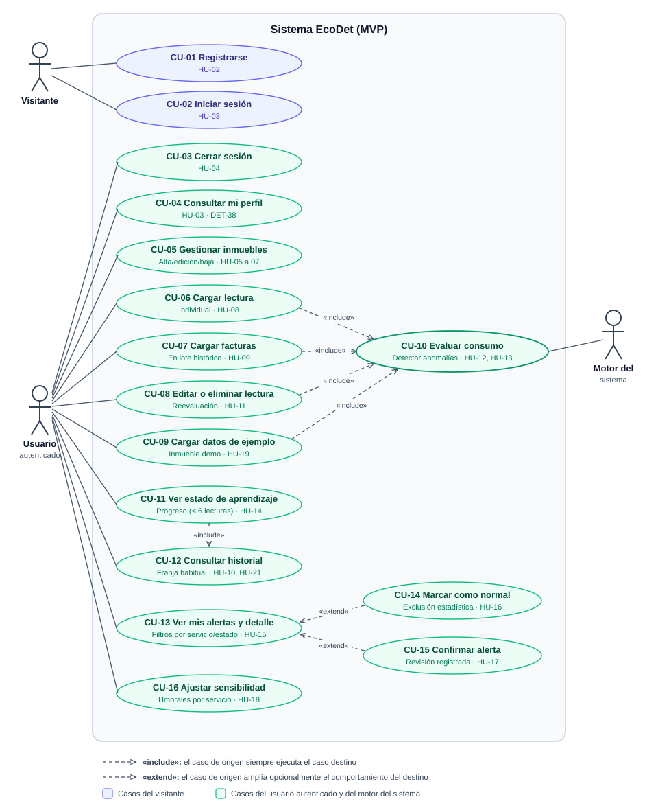
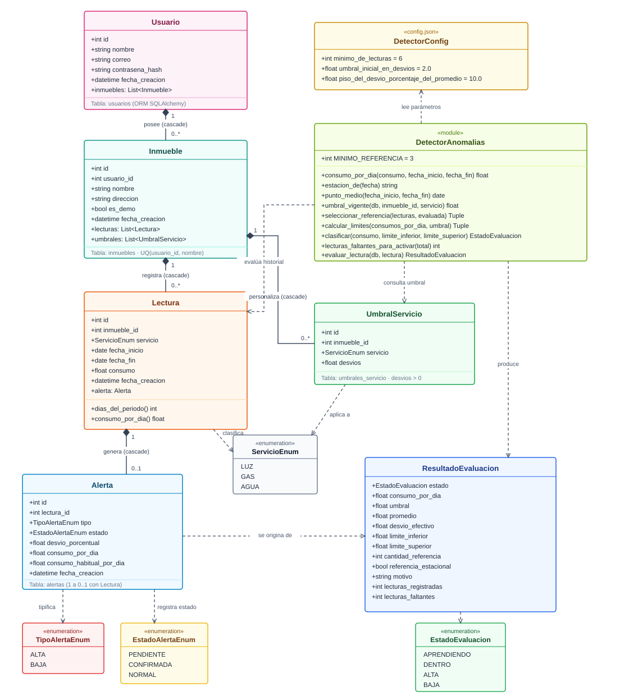

# EcoDet · Documentación de Análisis y Diseño
## Taller de Tecnología Aplicada (EGI) · Release 1 (MVP) — Sprints 1 y 2

**Cátedra:** Taller de Tecnología Aplicada (EGI)  
**Proyecto:** EcoDet — Detector de anomalías en consumo del hogar (Luz, Gas y Agua)  
**Equipo:** CuyoDevs  
**Fecha de Presentación:** Miércoles 25/11/2026  
**Repositorio GitHub:** [https://github.com/CuyoDevs/EcoDet](https://github.com/CuyoDevs/EcoDet)  
**Versión del documento:** 2.1 (corregida contra el catálogo oficial de reglas de negocio y el código del repositorio)

> **Fuentes de verdad.** Las reglas de negocio (RN-01 a RN-17) están definidas en `docs/producto/03-documentacion-de-apoyo.md`, sección 2. Su numeración se conserva tal cual porque la usan las historias de usuario, el código, los tests y las matrices de QA. El comportamiento descrito acá se verificó contra `backend/app/models.py`, `backend/app/schemas.py` y `backend/app/services/detector.py`.

---

# PARTE 1 · Diagrama de Casos de Uso

## 1.1. Actores del Sistema

| Actor | Tipo | Descripción |
| :--- | :--- | :--- |
| **Visitante** | Externo primario | Persona no registrada que puede registrarse o iniciar sesión. |
| **Usuario Autenticado** | Externo primario | Persona con cuenta activa que gestiona inmuebles, carga lecturas y consulta alertas. |
| **Motor del Sistema** | Interno (automatizado) | Módulo `backend/app/services/detector.py` que evalúa lecturas y genera alertas sin intervención humana. |

---

## 1.2. Diagrama General de Casos de Uso (UML)

---

## 1.3. Descripción Detallada de Casos de Uso

Este documento usa una numeración de casos de uso refinada (CU-01 a CU-16), que desglosa los 10 casos de uso del catálogo oficial (`03-documentacion-de-apoyo.md`). Los comentarios del código y las columnas "Usada en" del catálogo de reglas citan la numeración oficial, por eso se incluye la equivalencia en la columna **CU oficial**.

| ID | Caso de Uso | Actor Principal | Historias Asociadas | CU oficial | Descripción y Reglas de Negocio |
| :--- | :--- | :--- | :--- | :---: | :--- |
| **CU-01** | Registrarse | Visitante | HU-02 (DET-10) | CU-01 | Crea una cuenta con nombre, correo único y contraseña de al menos 8 caracteres con letras y números, guardada con hash `bcrypt` (RN-15). La cuenta nueva no ve datos de otros usuarios (RN-01). |
| **CU-02** | Iniciar sesión | Visitante | HU-03 (DET-11) | CU-02 | Valida credenciales y emite un token JWT. Ante credenciales incorrectas responde con un error genérico (RN-01, RN-19). |
| **CU-03** | Cerrar sesión | Usuario | HU-04 (DET-12) | CU-10 | Elimina el token en el cliente y vuelve a la pantalla de acceso. |
| **CU-04** | Consultar perfil | Usuario | HU-03 (DET-38) | — | Obtiene los datos del usuario autenticado mediante `GET /api/auth/me`. Es soporte técnico de CU-02 y no tiene un CU propio en el catálogo oficial. |
| **CU-05** | Gestionar inmuebles | Usuario | HU-05, HU-06, HU-07 (DET-13, 14, 15) | CU-03 | Alta, edición de nombre y dirección, y eliminación con confirmación. Eliminar un inmueble borra sus lecturas, alertas y umbrales (RN-18). Cada usuario solo ve sus inmuebles (RN-01). |
| **CU-06** | Cargar lectura individual | Usuario | HU-08 (DET-16) | CU-04 | Registra una lectura con fecha de inicio, fecha de fin y consumo físico (kWh o m³). Valida fechas (RN-03), valor mayor o igual a cero (RN-05), unidad física (RN-02) y ausencia de superposición (RN-14). El agua es opcional (RN-04). Calcula el consumo por día (RN-06) y dispara CU-10. |
| **CU-07** | Carga histórica en lote | Usuario | HU-09 (DET-17) | CU-04 (lote) | Ingresa varias facturas pasadas en una sola operación atómica (todo o nada), validando también la superposición dentro del lote (RN-14). Muestra un resumen con las lecturas cargadas y las alertas generadas. Dispara CU-10. |
| **CU-08** | Editar o eliminar lectura | Usuario | HU-11 (DET-19) | CU-09 | Modifica o elimina una lectura con las mismas validaciones que la carga. La lectura editada se vuelve a evaluar y su alerta se reemplaza; las alertas de otras lecturas no se recalculan (RN-17). |
| **CU-09** | Cargar datos de ejemplo | Usuario | HU-19 (DET-27) | CU-08 | Crea un inmueble de demostración con 24 meses de luz y gas y 12 de agua, con 2 anomalías altas y 1 baja por servicio. Solo se permite uno por usuario; si ya existe, avisa y no lo duplica (RN-16). |
| **CU-10** | Evaluar consumo y detectar anomalías | Sistema | HU-12, HU-13 (DET-20, 21) | CU-06 | Motor estadístico: exige 6 lecturas por servicio (RN-07), elige referencia estacional o general (RN-08), calcula límites promedio ± umbral × desvío efectivo (RN-09, RN-12), clasifica en alta o baja (RN-10, RN-20) y genera la alerta en estado Pendiente (RN-13). Excluye las lecturas marcadas como normales (RN-11). |
| **CU-11** | Ver estado de aprendizaje | Usuario | HU-14 (DET-22) | CU-06 / CU-04 | Con menos de 6 lecturas no se generan alertas: se muestra "aún estamos aprendiendo tu patrón", cuántas lecturas faltan y una barra de progreso (RN-07). |
| **CU-12** | Consultar historial y franja habitual | Usuario | HU-10, HU-21 (DET-18, 29) | CU-05 | Gráfico por servicio con detalle al seleccionar un punto. Resalta las lecturas con alerta. Permite mostrar u ocultar la franja habitual (promedio ± umbral) cuando el detector está activo. El agua sin datos no genera errores (RN-04). |
| **CU-13** | Ver mis alertas y su detalle | Usuario | HU-15 (DET-23) | CU-07 | Lista las alertas de un inmueble con servicio, período, tipo, desvío y estado, con filtros por servicio y estado. |
| **CU-14** | Marcar alerta como normal | Usuario | HU-16 (DET-24) | CU-07 | Pide confirmación y cambia el estado a `NORMAL`. La lectura queda fuera del promedio y del desvío en las detecciones siguientes (RN-11, RN-13, RN-17). |
| **CU-15** | Confirmar alerta | Usuario | HU-17 (DET-25) | CU-07 | Cambia el estado a `CONFIRMADA`: deja registrado que el usuario ya la revisó. No modifica el cálculo del detector (RN-13). |
| **CU-16** | Ajustar sensibilidad | Usuario | HU-18 (DET-26) | CU-07 | Permite cambiar el umbral (cantidad de desvíos) de cada servicio y cada inmueble. Acepta cualquier número mayor que cero; el valor inicial es 2. Aplica solo a detecciones futuras (RN-09, RN-17). |

---

# PARTE 2 · Diagrama de Clases del Dominio

## 2.1. Diagrama de Clases (UML)

---

## 2.2. Descripción de Clases y Responsabilidades

### 2.2.1. `Usuario`
- **Responsabilidad:** Representa la cuenta autenticable en el sistema.
- **Seguridad:** No guarda contraseñas en texto plano; guarda solo `contrasena_hash`, generado con `bcrypt` (RN-15).
- **Relaciones:** Posee una colección de `Inmuebles`. El modelo define el borrado en cascada de sus inmuebles; el MVP no incluye una funcionalidad para dar de baja la cuenta.

### 2.2.2. `Inmueble`
- **Responsabilidad:** Unidad física donde se miden los servicios (casa, departamento, comercio).
- **Campos:** `nombre`, `direccion` (opcional) y `es_demo`, que identifica el inmueble de demostración creado por "Cargar datos de ejemplo" (RN-16).
- **Regla en cascada:** Su eliminación borra sus lecturas, alertas y umbrales (HU-07, RN-18).
- **Alertas pendientes:** el conteo que muestra la tarjeta del inmueble lo calcula el endpoint `GET /api/inmuebles/`; no es un método del modelo.

### 2.2.3. `Lectura`
- **Responsabilidad:** Registra el consumo medido entre dos fechas para un servicio determinado.
- **Unidades físicas (RN-02):** kWh para Luz, m³ para Gas y Agua; nunca importes en dinero.
- **Restricciones de base de datos:** `consumo >= 0` (RN-05) y `fecha_fin >= fecha_inicio`.
- **Cálculos del modelo:**
  - `dias_del_periodo()`: cuenta inclusiva, `fecha_fin − fecha_inicio + 1`.
  - `consumo_por_dia()`: consumo dividido por los días del período (RN-06).
- **Estación del año:** no la calcula la lectura sino el detector (`estacion_de` y `punto_medio`), con estaciones meteorológicas del hemisferio sur (RN-08).

### 2.2.4. `Alerta`
- **Responsabilidad:** Entidad persistida cuando una lectura evaluada resulta anómala (`ALTA` o `BAJA`). Guarda el desvío porcentual sobre el promedio y el consumo por día frente al habitual.
- **Estados de ciclo de vida (RN-13):** nace `PENDIENTE` y pasa a `CONFIRMADA` o `NORMAL`; después no se vuelve a decidir. Los cambios de estado los hace `routers/alertas.py`.
  - `NORMAL`: el usuario indica que el consumo atípico tuvo motivo justificado (pileta, invitados, estufa). La lectura se excluye de las detecciones futuras (RN-11); lo ya calculado no se modifica (RN-17).
  - `CONFIRMADA`: el usuario valida que se trató de un consumo realmente anormal. No cambia el cálculo del detector (HU-17).

### 2.2.5. `UmbralServicio`
- **Responsabilidad:** Guarda la sensibilidad del detector para un servicio de un inmueble (HU-18). Hay como máximo un umbral por inmueble y servicio.
- **Campo:** `desvios`, cantidad de desvíos estándar. Acepta cualquier valor mayor que cero, sin tope superior (restricción `desvios > 0`).
- **Valor por defecto:** si no hay configuración propia se usa el umbral inicial del sistema, 2 desvíos (RN-09), definido en `backend/config.json`.
- **Efecto:** guardar un umbral no recalcula alertas ya generadas (RN-17).

### 2.2.6. `DetectorAnomalias` — Motor Estadístico del Dominio

Módulo `backend/app/services/detector.py`. El cálculo central son funciones puras (`consumo_por_dia`, `estacion_de`, `punto_medio`, `seleccionar_referencia`, `calcular_limites`, `clasificar`) que se prueban sin base de datos. Solo `umbral_vigente` y `evaluar_lectura` reciben una sesión de base de datos. Sus parámetros (`minimo_de_lecturas`, `umbral_inicial_en_desvios`, `piso_del_desvio_porcentaje_del_promedio`) se leen de `backend/config.json` mediante `DetectorConfig`. Algoritmo:

1. **Consumo por día (RN-06):** consumo / (fin − inicio + 1).
2. **Condición de aprendizaje (RN-07):** si el servicio tiene menos de 6 lecturas, devuelve `aprendiendo` e informa cuántas faltan. También devuelve `aprendiendo` si, tras descontar la lectura evaluada y las marcadas como normales, la referencia queda con menos de 3 lecturas.
3. **Selección de referencia (RN-08, RN-12):** la lectura evaluada nunca integra su propia referencia. Si hay al menos 3 lecturas de la misma estación (según el punto medio del período), la referencia es estacional; si no, es el historial general.
4. **Exclusión de normales (RN-11):** se ignoran las lecturas cuya alerta está en estado `NORMAL`.
5. **Cálculo de límites (RN-09, RN-12):** promedio simple y desvío estándar muestral (n−1). Desvío efectivo = el mayor entre el desvío muestral y el 10 % del promedio, para evitar falsas alarmas con consumos casi constantes. Límite superior = promedio + umbral × desvío efectivo; límite inferior = promedio − umbral × desvío efectivo. Ejemplo: promedio 20, desvío 3 y umbral 2 dan límites de 14 y 26.
6. **Clasificación (RN-10, RN-20):** `alta` si supera el límite superior, `baja` si queda bajo el inferior, `dentro` en otro caso. Con el ejemplo anterior, 31 es alta y 10 es baja.
7. **Resultado:** devuelve un `ResultadoEvaluacion`. El detector no persiste alertas: la creación de la alerta (HU-13) y su reemplazo al editar una lectura (HU-11) se hacen fuera de las funciones de cálculo.

---

## 2.3. Reglas de Negocio del Dominio

Catálogo oficial RN-01 a RN-17, agrupado por tema. La numeración es la de `docs/producto/03-documentacion-de-apoyo.md`.

### Cuenta y datos

| ID | Regla | Descripción |
| :--- | :--- | :--- |
| **RN-01** | Aislamiento de datos | Cada usuario accede únicamente a sus propios inmuebles, lecturas y alertas. |
| **RN-15** | Contraseña segura | Mínimo 8 caracteres, con letras y números, guardada con hash `bcrypt`. |

### Carga de lecturas

| ID | Regla | Descripción |
| :--- | :--- | :--- |
| **RN-02** | Consumo físico | Solo se carga consumo físico, nunca dinero: luz en kWh, gas y agua en m³. |
| **RN-03** | Fechas de lectura | La fecha de fin no puede ser anterior a la de inicio ni posterior a la fecha actual. |
| **RN-04** | Agua opcional | La aplicación opera solo con luz y gas, sin errores, si falta el agua. |
| **RN-05** | Valor del consumo | Numérico y mayor o igual a cero (el 0 es válido). |
| **RN-14** | Sin superposición | Dos lecturas del mismo servicio e inmueble no pueden superponerse en fechas. |

### Detector

| ID | Regla | Descripción |
| :--- | :--- | :--- |
| **RN-06** | Consumo por día | `consumo / (fecha_fin − fecha_inicio + 1)`, con cuenta inclusiva de días. |
| **RN-07** | Mínimo de lecturas | 6 lecturas por servicio e inmueble. Con menos se muestra "aún estamos aprendiendo tu patrón". Si tras excluir las normales la referencia queda con menos de 3, tampoco se evalúa. |
| **RN-08** | Referencia y estación | Con 3 o más lecturas de la misma estación (meteorológica, hemisferio sur, según el punto medio del período) se usa esa referencia; si no, el historial general. |
| **RN-09** | Umbral | Valor inicial de 2 desvíos, configurable por servicio e inmueble (mayor que 0). |
| **RN-10** | Alertas alta y baja | Alta si supera el límite superior; baja si queda bajo el límite inferior. |
| **RN-12** | Cálculo estadístico | Promedio simple, desvío muestral (n−1) y piso del 10 % del promedio. La lectura evaluada queda fuera de su propia referencia. |

### Alertas y retroalimentación

| ID | Regla | Descripción |
| :--- | :--- | :--- |
| **RN-11** | Alerta "normal" | La lectura marcada como normal se excluye de las detecciones futuras. |
| **RN-13** | Estados de alerta | Nace en `Pendiente`; puede pasar a `Confirmada` o `Normal`. |
| **RN-17** | Hacia adelante | Los cambios de configuración y el marcado como normal aplican solo a detecciones futuras; no recalculan alertas ya generadas. |

### Datos de ejemplo

| ID | Regla | Descripción |
| :--- | :--- | :--- |
| **RN-16** | Datos de ejemplo | Solo un inmueble de demostración por usuario: identificable, eliminable y recargable. |

### Reglas implementadas que todavía no figuran en el catálogo (propuestas)

Están implementadas y probadas pero no tienen número en el catálogo oficial. Se proponen como RN-18 a RN-20, sin renumerar las anteriores.

| ID | Regla | Descripción |
| :--- | :--- | :--- |
| **RN-18** | Borrado en cascada | Eliminar un inmueble elimina sus lecturas, alertas y umbrales (criterio de HU-07). |
| **RN-19** | Sesión con JWT | El inicio de sesión emite un token JWT con expiración (1440 minutos por defecto, configurable con `ACCESS_TOKEN_EXPIRE_MINUTES`), validado en cada request protegido. |
| **RN-20** | Límites inclusivos | Un consumo exactamente igual a un límite se considera dentro del rango habitual; solo se alerta al superarlo. |
