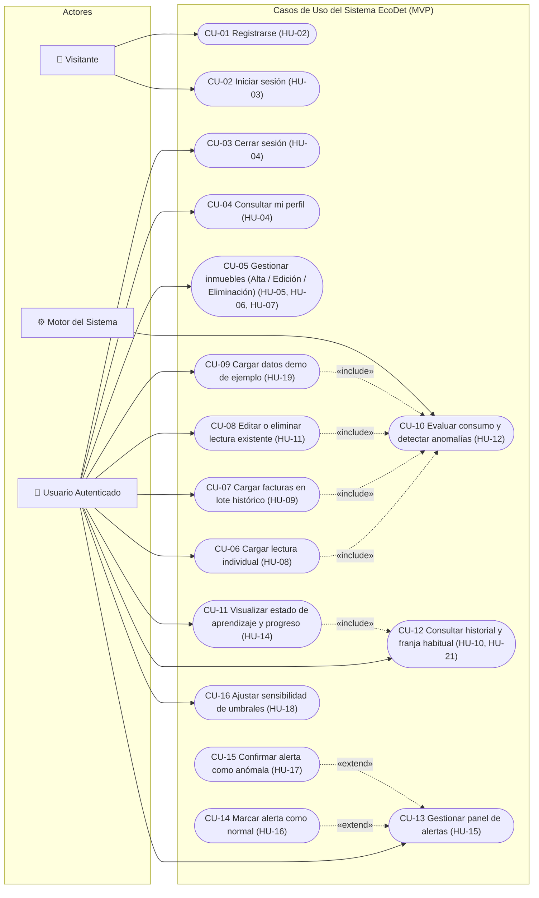
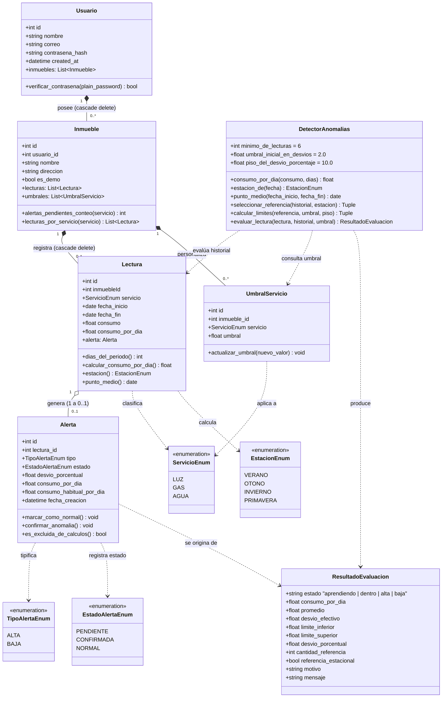

# EcoDet · Documentación de Análisis y Diseño
## Taller de Tecnología Aplicada (EGI) · Release 1 (MVP) — Sprints 1 y 2

**Cátedra:** Taller de Tecnología Aplicada (EGI)  
**Proyecto:** EcoDet — Detector de anomalías en consumo del hogar (Luz, Gas y Agua)  
**Equipo:** CuyoDevs  
**Fecha de Presentación:** Miércoles 25/11/2026  
**Repositorio GitHub:** [https://github.com/CuyoDevs/EcoDet](https://github.com/CuyoDevs/EcoDet)  
**Versión del documento:** 2.0 (Refinada tras el cierre del Sprint 2)

---

# PARTE 1 · Diagrama de Casos de Uso

## 1.1. Actores del Sistema

| Actor | Tipo | Descripción |
| :--- | :--- | :--- |
| **Visitante** | Externo primario | Persona no registrada que puede registrarse o iniciar sesión. |
| **Usuario Autenticado** | Externo primario | Persona con cuenta activa que gestiona inmuebles, carga lecturas y consulta alertas. |
| **Motor del Sistema** | Interno (automatizado) | Módulo `detector.py` que evalúa lecturas y emite alertas sin intervención humana. |

---

## 1.2. Diagrama General de Casos de Uso (Mermaid)

---

## 1.3. Descripción Detallada de Casos de Uso

| ID | Caso de Uso | Actor Principal | Historias Asociadas | Descripción y Reglas de Negocio |
| :--- | :--- | :--- | :--- | :--- |
| **CU-01** | Registrarse | Visitante | HU-02 (DET-10) | Permite crear una cuenta nueva con nombre, correo único y contraseña cifrada con `bcrypt` (RN-01, RN-15). |
| **CU-02** | Iniciar sesión | Visitante | HU-03 (DET-11) | Valida credenciales y emite un token JWT con expiración configurable (RN-15). |
| **CU-03** | Cerrar sesión | Usuario | HU-04 (DET-12) | Revoca el token en el cliente y redirige a la pantalla pública de bienvenida. |
| **CU-04** | Consultar perfil | Usuario | HU-04 (DET-12) | Obtiene los datos del usuario logueado mediante `GET /api/auth/me`. |
| **CU-05** | Gestionar inmuebles | Usuario | HU-05, HU-06, HU-07 (DET-13, 14, 15) | Alta, edición de nombre/dirección y **eliminación con borrado en cascada** de lecturas y alertas vinculadas. |
| **CU-06** | Cargar lectura individual | Usuario | HU-08 (DET-16) | Registra una lectura con fecha de inicio, fin y consumo en unidad física (kWh/m³). Prorratea el consumo por día (RN-02, RN-03). Dispara CU-10. |
| **CU-07** | Carga histórica en lote | Usuario | HU-09 (DET-17) | Permite ingresar múltiples facturas pasadas en una sola operación atómica (todo-o-nada). Dispara CU-10. |
| **CU-08** | Editar o eliminar lectura | Usuario | HU-11 (DET-19) | Modifica fechas/consumo o suprime una lectura. Reevalúa inmediatamente la alerta asociada (RN-17). Dispara CU-10. |
| **CU-09** | Cargar datos demo | Usuario | HU-19 (DET-27) | Pobla el inmueble con facturas de prueba y curvas estacionales para evaluación del sistema. |
| **CU-10** | Detectar anomalías | Sistema | HU-12, HU-13 (DET-20, 21) | Motor estadístico: verifica si hay ≥ 6 lecturas (RN-07), calcula estacionalidad (RN-08), límites µ ± (k × σ) (RN-09/10), aplica piso del 10% (RN-12) y emite alertas ALTA/BAJA en estado PENDIENTE. |
| **CU-11** | Ver estado de aprendizaje | Usuario | HU-14 (DET-22) | Muestra si el detector está aprendiendo (< 6 lecturas), indicando exactamente cuántas facturas faltan mediante barra de progreso interactiva. |
| **CU-12** | Consultar historial y franja | Usuario | HU-10, HU-21 (DET-18, 29) | Gráficos Chart.js interactivos por servicio con tooltips y sombreado de la franja de consumo habitual entre límite inferior y superior. |
| **CU-13** | Gestionar panel de alertas | Usuario | HU-15 (DET-23) | Muestra la lista de alertas pendientes/resueltas con filtros por servicio y estado, indicando el desvío porcentual. |
| **CU-14** | Marcar alerta como normal | Usuario | HU-16 (DET-24) | El usuario indica que el consumo atípico tuvo causa justificada. Cambia estado a `NORMAL` y se **excluye de cálculos futuros** (RN-11). |
| **CU-15** | Confirmar alerta | Usuario | HU-17 (DET-25) | El usuario confirma que la anomalía fue una pérdida o fuga real. Cambia estado a `CONFIRMADA`. |
| **CU-16** | Ajustar sensibilidad | Usuario | HU-18 (DET-26) | Permite modificar el umbral k de desvíos estándar (entre 1.0 y 3.0) de forma independiente por inmueble y servicio. |

---

---

# PARTE 2 · Diagrama de Clases del Dominio

## 2.1. Diagrama de Clases (Mermaid)

---

## 2.2. Descripción de Clases y Responsabilidades

### 2.2.1. `Usuario`
- **Responsabilidad:** Representa la cuenta autenticable en el sistema.
- **Seguridad:** No almacena contraseñas en texto plano; guarda únicamente `contrasena_hash` generado con salt individual mediante `bcrypt` (RN-01, RN-15).
- **Relaciones:** Posee una colección de `Inmuebles`. Al eliminarse el usuario, se eliminan sus inmuebles por cascada.

### 2.2.2. `Inmueble`
- **Responsabilidad:** Unidad física donde se miden los servicios (casa, departamento, comercio).
- **Campos:** `nombre`, `direccion`, `es_demo` (identifica cuentas de ejemplo preconfiguradas).
- **Regla en cascada:** Su eliminación elimina automáticamente todas las lecturas y alertas hijas (HU-07 / RN-16).
- **Métodos:**
  - `alertas_pendientes_conteo(servicio)`: Calcula la cantidad de anomalías no resueltas para los badges de la UI (HU-15).
  - `lecturas_por_servicio(servicio)`: Filtra y ordena cronológicamente las facturas del inmueble.

### 2.2.3. `Lectura`
- **Responsabilidad:** Registra el consumo medido entre dos fechas para un servicio determinado.
- **Unidades Físicas (RN-02):** kWh para Luz, m³ para Gas y Agua (nunca importes en dinero).
- **Métodos de Negocio:**
  - `dias_del_periodo()`: Diferencia en días entre `fecha_fin` y `fecha_inicio` (debe ser ≥ 1).
  - `calcular_consumo_por_dia()`: Prorratea el consumo: consumo / dias (RN-03).
  - `punto_medio()`: Calcula la fecha media del período para determinar la estación climática representativa.
  - `estacion()`: Devuelve `VERANO`, `OTONO`, `INVIERNO` o `PRIMAVERA` según las fechas astronómicas de Argentina (RN-08).

### 2.2.4. `Alerta`
- **Responsabilidad:** Entidad persistida cuando una lectura evaluada resulta anómala (`ALTA` o `BAJA`).
- **Estados de Ciclo de Vida:**
  - `PENDIENTE`: Estado inicial al ser detectada la anomalía.
  - `NORMAL`: El usuario indica que el consumo atípico tuvo motivo justificado (pileta, invitados, estufa). **Efecto clave:** La lectura asociada se excluye de los cálculos futuros para no contaminar la media habitual (RN-11, RN-17).
  - `CONFIRMADA`: El usuario valida que se trató de una fuga, pérdida o problema real (HU-17).

### 2.2.5. `UmbralServicio`
- **Responsabilidad:** Permite al usuario ajustar la sensibilidad del detector por servicio e inmueble (HU-18).
- **Comportamiento:** Si no existe configuración particular, se aplica el valor global por defecto (k = 2.0 desvíos estándar según RN-09). Valores admitidos: 1.0 ≤ k ≤ 3.0.

### 2.2.6. `DetectorAnomalias` — Motor Estadístico del Dominio

Módulo de **funciones puras e independientes de base de datos** (`backend/app/detector.py`) que implementa el algoritmo estadístico de detección:

1. **Condición de aprendizaje:** Si el historial tiene menos de 6 lecturas, devuelve `estado = "aprendiendo"` e indica las lecturas faltantes (RN-07).
2. **Selección de referencia:** Si existen ≥ 2 lecturas de la misma estación, usa la referencia estacional; de lo contrario, usa el historial general (RN-08).
3. **Exclusión de normales:** Ignora lecturas con alertas marcadas como `NORMAL` (RN-11).
4. **Cálculo de límites:**
   - Límite Superior = µ + (k × σ)
   - Límite Inferior = µ − (k × σ)
5. **Piso de desvío (RN-12):** Si σ < 0.10 × µ, se fuerza σ = 0.10 × µ para evitar alarmas falsas ante consumos planos.
6. **Clasificación:** Devuelve `ResultadoEvaluacion` con estado `alta`, `baja` o `dentro`.

---

## 2.3. Reglas de Negocio Clave del Dominio

| ID | Regla | Descripción |
| :--- | :--- | :--- |
| **RN-01** | Hash de contraseña | Las contraseñas se almacenan exclusivamente como hash `bcrypt` con salt individual. |
| **RN-02** | Unidades físicas | Las lecturas expresan siempre la cantidad física consumida: kWh (luz) o m³ (gas, agua). |
| **RN-03** | Prorrateo diario | `consumo_por_dia = consumo_total / (fecha_fin − fecha_inicio)` en días. |
| **RN-07** | Mínimo de lecturas | El detector requiere al menos 6 lecturas del mismo servicio para activarse. |
| **RN-08** | Estacionalidad | Si hay ≥ 2 lecturas de la misma estación astronómica, la comparación es estacional (Argentina). |
| **RN-09** | Umbral por defecto | k = 2.0 desvíos estándar. Alerta si consumo > µ + 2σ (ALTA) o < µ − 2σ (BAJA). |
| **RN-11** | Exclusión de normales | Las lecturas marcadas `NORMAL` se excluyen de los cálculos estadísticos futuros. |
| **RN-12** | Piso de desvío | El desvío efectivo nunca puede ser menor al 10% de la media para evitar falsos positivos. |
| **RN-15** | Seguridad de tokens | Los tokens JWT tienen tiempo de expiración y se validan en cada request protegido. |
| **RN-16** | Borrado en cascada | Eliminar un inmueble elimina automáticamente todas sus lecturas y alertas. |
| **RN-17** | Re-evaluación | Editar o eliminar una lectura desencadena la re-evaluación inmediata de su alerta. |
