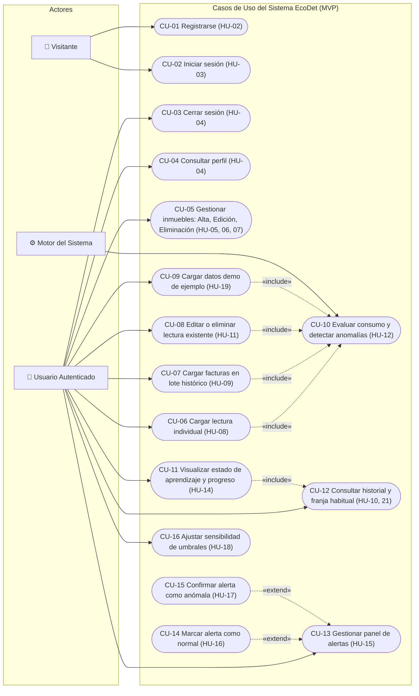
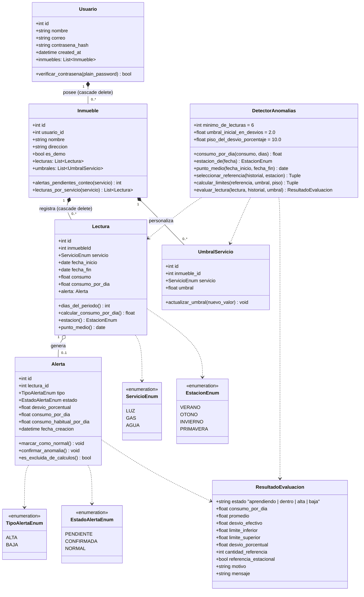
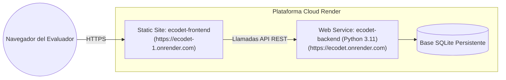

# EcoDet · Documentación Integral para Presentación Final (EGI)
## Taller de Tecnología Aplicada · Proyecto: Implementación de Scrum con Jira

**Cátedra:** Taller de Tecnología Aplicada (EGI)  
**Fecha de Presentación:** Miércoles 25/11/2026  
**Horarios de Exposición:** Comisión A: 17:30 a 19:30 h. · Comisión B: 15:30 a 17:30 h.  
**Proyecto:** EcoDet — Detector de anomalías en consumo del hogar (Luz, Gas y Agua)  
**Versión:** 1.0 (Release 1 - MVP) · Alcance: 2 Sprints Scrum completados al 100%

---

## 👥 Equipo de Proyecto y Roles

| Rol | Integrante | Responsabilidades |
| :--- | :--- | :--- |
| **Product Owner** | Mateo Luján | Visión del producto, priorización del Product Backlog, criterios de aceptación (DoR/DoD), validación funcional ante stakeholders. |
| **Scrum Master** | Ari | Facilitación de ceremonias ágiles, eliminación de impedimentos, seguimiento del tablero Jira y flujo Gitflow. |
| **Developers** | Josue, Gimena, Ari, Angel, William, Lisandro, Mateo | Arquitectura, endpoints FastAPI, detector estadístico, componentes React 18, pruebas automáticas unitarias/QA y despliegue. |

### 🔗 Enlaces Oficiales de Acceso
- **Repositorio de Código:** [https://github.com/CuyoDevs/EcoDet](https://github.com/CuyoDevs/EcoDet)
- **Tablero Jira:** [https://mateolujan13.atlassian.net/jira/software/projects/DET/boards/2](https://mateolujan13.atlassian.net/jira/software/projects/DET/boards/2)
- **Aplicación Web en Producción (Frontend):** [https://ecodet-1.onrender.com](https://ecodet-1.onrender.com)
- **API Backend & Swagger UI:** [https://ecodet.onrender.com/docs](https://ecodet.onrender.com/docs)
- **Diagnóstico y Salud de Base de Datos:** [https://ecodet.onrender.com/api/health](https://ecodet.onrender.com/api/health)

---

# ÍNDICE GENERAL DE LA ENTREGA

1. [PARTE 1 · Bitácora de Sprints 1 y 2](#parte-1--bitácora-de-sprints-1-y-2)
   - 1.1. Bitácora del Sprint 1 (Cimientos Técnicos, Datos e Interfaz)
   - 1.2. Bitácora del Sprint 2 (Detección de Anomalías, Alertas y Ajustes)
2. [PARTE 2 · Documentación de Análisis y Diseño](#parte-2--documentación-de-análisis-y-diseño)
   - 2.1. Diagrama de Casos de Uso Refinado
   - 2.2. Diagrama de Clases del Dominio Refinado
   - 2.3. Lógica y Fórmulas del Motor Estadístico
3. [PARTE 3 · Documentos de Operación y Despliegue](#parte-3--documentos-de-operación-y-despliegue)
   - 3.1. Manual de Usuario (Guía Funcional Paso a Paso)
   - 3.2. Documentación de Instalación y Ejecución Local
   - 3.3. Documentación de Despliegue en Producción (Cloud Render)

---

# PARTE 1 · Bitácora de Sprints 1 y 2

Esta bitácora sigue rigurosamente los **6 bloques oficiales** de la estructura propuesta por la cátedra para registrar la trazabilidad real del desarrollo.

---

## 1.1. Bitácora del Sprint 1

### 1. Encabezado del Sprint
- **Equipo:** CuyoDevs
- **Número de Sprint:** Sprint 1 (`DET Sprint 1` en Jira)
- **Fechas:** 19/10/2026 al 02/11/2026 (10 días hábiles / 2 semanas)
- **Roles:** PO: Mateo Luján · SM: Ari · Developers: Josue, Gimena, Ari, Angel, William, Lisandro, Mateo
- **Sprint Goal:** *"Base técnica, cuentas de usuario seguras, gestión de inmuebles, carga de lecturas (individual y en lote) e historial interactivo con gráficos por servicio."*
- **Capacidad estimada del equipo:** 29 puntos de historia (7 desarrolladores activos con disponibilidad académica de 10 horas semanales c/u).

### 2. Planificación (Sprint Planning)
- **Ítems seleccionados del Product Backlog:**
  - **DET-9 (HU-01):** Base técnica y documentación del entorno (FastAPI + React + SQLite) — 5 pts
  - **DET-10 (HU-02):** Registro de usuario con hash seguro `bcrypt` — 3 pts
  - **DET-11 (HU-03):** Inicio de sesión seguro con JWT — 3 pts
  - **DET-12 (HU-04):** Cerrar sesión y consultar datos del usuario logueado (`/api/auth/me`) — 2 pts
  - **DET-13 (HU-05):** Alta y consulta de inmuebles — 3 pts
  - **DET-14 (HU-06):** Edición de inmuebles existentes — 2 pts
  - **DET-16 (HU-08):** Carga individual de lectura de consumo con prorrateo diario — 3 pts
  - **DET-17 (HU-09):** Carga histórica de lecturas en lote (modo todo-o-nada) — 5 pts
  - **DET-18 (HU-10):** Ver historial y gráficos interactivos por servicio (Chart.js) — 3 pts
  - **Total comprometido:** 29 puntos de historia.
- **Plan inicial:** Establecer monorepo con `ADR-001`, construir el backend de autenticación e inmuebles en paralelo con los componentes de UI en React/Tailwind, e integrar gráficos en la segunda semana.
- **Supuestos, dependencias y riesgos:** Se asume que las lecturas se cargan en kWh o m³ (no dinero). Dependencia: la carga de consumos requiere inmuebles persistidos. Riesgo: incompatibilidad de librerías de hash.
- **Definition of Done (DoD):** Tipado Pydantic V2, pruebas `pytest` y `vitest` en verde, cero secretos en git, validación del PO y squash merge por PR aprobado.

### 3. Registro Diario (Daily Scrum - Sprint 1)

| Fecha | ¿Vamos bien encaminados? | Avance relevante | Impedimentos | Decisiones o ajustes al plan |
| :---: | :--- | :--- | :--- | :--- |
| **19/10** | Sí | Creación del repositorio `CuyoDevs/EcoDet`, `README.md` base y plantilla de PR. | Ninguno. | Convención estricta de ramas `DET-<id>-descripcion`. |
| **21/10** | Sí | Configuración del proyecto `DET` en Jira y carga del Product Backlog refinado. | Ninguno. | Se prioriza definir el stack técnico en `ADR-001`. |
| **25/10** | Sí | Configuración de `.gitignore` para monorepo (Python `.venv` y Node `node_modules`). | Archivos temporales no ignorados. | Se ajustan exclusiones de git. |
| **26/10** | Sí | **DET-9:** Base técnica completa. Servidores backend y frontend corriendo y documentados. | Ninguno. | Se adopta SQLite con SQLAlchemy 2.0 para el MVP. |
| **27/10** | Sí | **DET-10 (HU-02):** Registro de usuarios implementado con hash seguro y validaciones. | Subida accidental de `.zip` al PR. | Se elimina el zip, se agrega `*.zip` al gitignore y se hace squash merge. |
| **28/10** | Sí | **DET-11:** Endpoints `POST /api/auth/login` y `GET /api/auth/me` con JWT listos. | `passlib` arroja warning en Python 3.12. | Se decide usar directamente la librería nativa `bcrypt` (RN-15). |
| **30/10** | Sí | Formulario de Login en React conectado con persistencia de token en `localStorage`. | Manejo de expiración de sesión. | Se centraliza el interceptor de 401 en `client.js`. |
| **31/10** | Sí | **DET-13** y **DET-14:** Backend y modales frontend para alta y edición de inmuebles. | Validación de campos vacíos. | Se estandarizan errores 422 en español por campo. |
| **01/11** | Sí | **DET-12 (HU-04):** Botón y flujo de cerrar sesión completado y testeado. | Ninguno. | Se prepara la carga de consumos. |
| **02/11** | Sí, cierre exitoso | **DET-16, DET-17 y DET-18:** Carga individual, lote histórico e historial con gráficos terminados. | Sincronización final de PRs. | Revisiones cruzadas rápidas y cierre del Sprint 1. |

### 4. Impedimentos y Decisiones (Sprint 1)
- **Impedimento 1 (Librería `passlib` obsoleta):** Fallaba con `bcrypt >= 4.0`. Se reemplazó por la librería nativa `bcrypt` en `backend/app/security.py`. Demora: 3 horas.
- **Impedimento 2 (Archivo zip en commit):** Se subió un zip por error en el ticket de registro. Se purgó el historial de la rama y se configuró `.gitignore`. Demora: 1 hora.
- **Decisiones Relevantes:** Mantener SQLite para simplificar la portabilidad del MVP sin requerir configurar servidores de base de datos externos en las máquinas de los alumnos. Formatear errores 422 en español para mostrar mensajes bajo cada input.

### 5. Cierre del Sprint 1
- **Sprint Review (02/11/2026):** Se realizó la demostración en vivo del registro de usuario, alta de inmueble "Casa Principal", carga por lote de 6 facturas históricas de luz y visualización de la curva en Chart.js. Feedback positivo de la interfaz.
- **Resultado frente al Sprint Goal:** **Cumplido al 100%.**
- **Métricas:** 29 puntos planificados vs 29 puntos completados (0 puntos arrastrados). 9 historias terminadas.

### 6. Retrospectiva (Sprint 1)
- **Qué funcionó:** El flujo de ramas y squash merge evitó roturas en `main`. Excelente coordinación entre frontend y backend.
- **Qué no funcionó / Aprendizaje:** La validación manual de DoD se hacía a último momento.
- **Acuerdos de mejora para el Sprint 2:** 
  1. Escribir una matriz de pruebas de QA manual (`qa-HU-xx.md`) por cada historia antes de considerarla lista.
  2. Automatizar tests unitarios obligatorios en cada PR.

---

## 1.2. Bitácora del Sprint 2

### 1. Encabezado del Sprint
- **Equipo:** CuyoDevs
- **Número de Sprint:** Sprint 2 (`DET Sprint 2` en Jira)
- **Fechas:** 02/11/2026 al 24/11/2026 (15 días hábiles / 3 semanas)
- **Roles:** PO: Mateo Luján · SM: Ari · Developers: Josue, Gimena, Ari, Angel, William, Lisandro, Mateo
- **Sprint Goal:** *"Motor estadístico del detector de anomalías (estacionalidad y umbrales), persistencia y visualización de alertas, estado 'aprendiendo', confirmación/marcado de alertas y ajuste de sensibilidad."*
- **Capacidad estimada del equipo:** 31 puntos de historia.

### 2. Planificación (Sprint Planning)
- **Ítems seleccionados:**
  - **DET-15 (HU-07):** Eliminar inmueble con borrado en cascada — 3 pts
  - **DET-19 (HU-11):** Editar y eliminar lecturas y reevaluar alertas — 3 pts
  - **DET-20 (HU-12):** Motor estadístico del detector (estacionalidad y umbrales) — 5 pts
  - **DET-21 (HU-13):** Recibir alerta de consumo alto o bajo persistida — 5 pts
  - **DET-22 (HU-14):** Estado 'aprendiendo' del detector ($< 6$ lecturas) — 2 pts
  - **DET-23 (HU-15):** Panel central de alertas con filtros — 5 pts
  - **DET-24 (HU-16):** Marcar una alerta como "normal" (exclusión estadística) — 3 pts
  - **DET-25 (HU-17):** Confirmar una alerta — 2 pts
  - **DET-26 (HU-18):** Ajuste de sensibilidad del detector por servicio e inmueble — 2 pts
  - **DET-27 (HU-19):** Generación de datos de prueba (`seed.py`) — Subtareas
  - **DET-29 (HU-21):** Ver franja de consumo habitual en gráficos — 3 pts
  - **Total comprometido:** 31 puntos de historia.
- **Plan inicial:** Aislar la lógica matemática en `detector.py` como funciones puras para asegurar cobertura matemática total; luego acoplar la persistencia de alertas, UI de alertas, ajustes de sensibilidad y despliegue.
- **Riesgos:** Falsas alarmas en consumos con desvío estándar nulo (consumo constante). Se mitiga implementando la regla RN-12 (piso mínimo del 10%).

### 3. Registro Diario (Daily Scrum - Sprint 2)

| Fecha | ¿Vamos bien encaminados? | Avance relevante | Impedimentos | Decisiones o ajustes al plan |
| :---: | :--- | :--- | :--- | :--- |
| **03/11** | Sí | Planificación formal del Sprint 2 y desglose de subtareas en Jira. | Ninguno. | Se asignan parejas de trabajo. |
| **05/11** | Sí | Definición de fórmulas de estacionalidad (trimestres astronómicos de Argentina). | Dudas en fechas de solsticios. | Se fijan rangos de fechas por estación (RN-08). |
| **12/11** | Sí | **DET-15 (HU-07):** Eliminar inmueble con borrado en cascada completado (PR #21). | Ruta relativa en base de test. | Se fija path absoluto en `test_inmuebles.py`. |
| **13/11** | Sí | **DET-19 (HU-11):** Endpoints PUT y DELETE de lecturas terminados (PR #22 y #23). | Ninguno. | Reevaluación inmediata de alertas. |
| **13/11** | Sí, hito clave | **DET-20 (HU-12):** Motor estadístico `detector.py` finalizado con 42 tests unitarios (PR #24). | Consumos planos con desvío 0. | Se aplica estrictamente RN-12 (piso del 10% del promedio). |
| **15/11** | Sí | **DET-21 (HU-13):** Persistencia de Alertas y advertencia inmediata en formulario (PR #25). | Diferenciar alta vs baja. | Se enriquece la respuesta con % de desvío. |
| **17/11** | Sí | **DET-22 (HU-14):** Estado 'aprendiendo' con contador de lecturas y barra de progreso (PR #26). | Ninguno. | Avisos visuales en W3 y W4. |
| **18/11** | Sí | **DET-23 (HU-15):** Componente `PanelAlertas` con filtros por servicio y badges (PR #27). | Conteo en tarjetas de inmuebles. | Se añade campo computado `alertas_pendientes`. |
| **19/11** | Sí | **DET-24 (HU-16):** Funcionalidad de marcar alerta como normal terminada (PR #28). | Exclusión en re-cálculos. | Se filtra en `detector.py` para ignorar normales. |
| **20/11** | Sí | **DET-26, DET-27, DET-29, DET-25:** Sensibilidad, datos de prueba, franja y confirmación (PRs #29 a #32). | Ninguno. | Backlog completo del Sprint 2 integrado a `main`. |
| **24/11** | Sí, despliegue final | Blueprint `render.yaml`, compatibilidad CORS, 524 pruebas automáticas y puesta en producción en la nube. | Token de Jira expirado y CORS inicial. | Backend en `ecodet.onrender.com` y frontend en `ecodet-1.onrender.com` operativos. |

### 4. Impedimentos y Decisiones (Sprint 2)
- **Impedimento 1 (Desvío estándar nulo):** Lecturas consecutivas con idéntico consumo generaban división por cero o umbrales idénticos a la media. Se implementó la regla RN-12 (piso del 10% del promedio como umbral mínimo). Demora: 4 horas.
- **Impedimento 2 (Conexión CORS en Render):** El frontend en `ecodet-1.onrender.com` requería comunicarse con `ecodet.onrender.com`. Se configuró `allow_origin_regex` en FastAPI y autoconexión en `client.js`. Demora: 1 hora.
- **Decisiones Relevantes:** Precargar datos demostrativos en el arranque del servidor (`seed.py`) para que la mesa evaluadora cuente con casos de prueba listos.

### 5. Cierre del Sprint 2
- **Sprint Review (24/11/2026):** Demostración completa en la nube: alerta de luz anómala (450 kWh, salto a más del doble), curva estacional de gas en invierno, estado aprendiendo en agua (3/6 lecturas), ajuste de sensibilidad de 2.0 a 1.5 desvíos y franja habitual sombreada en el gráfico.
- **Resultado frente al Sprint Goal:** **Cumplido al 100%.**
- **Métricas:** 31 puntos planificados vs 31 puntos completados. 524 pruebas automáticas en verde (294 backend + 230 frontend).

### 6. Retrospectiva (Sprint 2)
- **Qué funcionó:** Las matrices de QA individuales (`qa-HU-07.md` a `qa-HU-19.md`) aseguraron que cada historia cumpliera el 100% de los criterios de aceptación antes de mergearse.
- **Qué aprendimos:** La importancia de automatizar el despliegue mediante Infraestructura como Código (Blueprint) para garantizar reproducibilidad exacta entre entornos.
- **Seguimiento de acuerdos del Sprint 1:** Se cumplieron al 100% ambos acuerdos (matrices de QA por historia y suite de pruebas continua en cada PR).

---

# PARTE 2 · Documentación de Análisis y Diseño

## 2.1. Diagrama de Casos de Uso Refinado



### Matriz de Casos de Uso Refinados:
- **CU-01 a CU-04 (Autenticación y Sesión):** Registro con hash `bcrypt` (RN-01), login con emisión de JWT (RN-15) y consulta de perfil.
- **CU-05 (Inmuebles):** Alta, modificación de nombre/dirección y borrado con eliminación en cascada de lecturas y alertas (RN-16).
- **CU-06 a CU-09 (Carga de Consumos):** Validación de períodos sin solapamiento (RN-04), prorrateo diario $\frac{\text{consumo}}{\text{dias}}$ (RN-03) en unidades físicas (RN-02). Toda inserción o edición reevalúa automáticamente las alertas mediante CU-10 (RN-17).
- **CU-10 (Detección de Anomalías):** Ejecuta el motor estadístico, valida el mínimo de 6 lecturas (RN-07), selecciona referencia estacional (RN-08) y emite alertas `ALTA` o `BAJA`.
- **CU-11 y CU-12 (Visualización):** Informa estado "Aprendiendo" ($< 6$ facturas) con barra de progreso; renderiza gráficos de Chart.js con la franja habitual sombreada entre límite inferior y superior.
- **CU-13 a CU-16 (Gestión de Alertas y Ajustes):** Filtrado por servicio y estado; cambio de estado a `NORMAL` (con exclusión estadística futura según RN-11), `CONFIRMADA`, y ajuste del umbral de tolerancia $k$ entre 1.0 y 3.0 desvíos estándar.

---

## 2.2. Diagrama de Clases del Dominio Refinado



---

## 2.3. Lógica y Fórmulas del Motor Estadístico

El detector opera como un conjunto de funciones matemáticas puras (`backend/app/detector.py`):

1. **Prorrateo Diario (RN-03):**
   $$c_{\text{diario}} = \frac{\text{consumo}}{\text{dias}}$$

2. **Condición de Aprendizaje (RN-07):**
   $$\text{Si } N_{\text{historial}} < 6 \implies \text{Estado: "aprendiendo"} \quad (\text{faltan } 6 - N \text{ facturas})$$

3. **Selección de Referencia Estacional (RN-08):**
   - Se calcula el punto medio de la factura para determinar la estación climática en Argentina:
     - Verano: 21 dic - 20 mar | Otoño: 21 mar - 20 jun | Invierno: 21 jun - 20 sep | Primavera: 21 sep - 20 dic.
   - Si existen $\ge 2$ lecturas previas en la misma estación, se toma como referencia ese conjunto; de lo contrario, se usa todo el historial general.
   - **Exclusión de normales (RN-11):** Se excluyen de la muestra aquellas lecturas cuya alerta fue marcada como `NORMAL`.

4. **Cálculo de Parámetros Estadísticos:**
   $$\mu = \frac{1}{N} \sum_{i=1}^N c_i \qquad \sigma = \sqrt{\frac{1}{N-1} \sum_{i=1}^N (c_i - \mu)^2}$$

5. **Piso del Desvío Estándar (RN-12):**
   $$\sigma_{\text{efectivo}} = \max(\sigma, \; 0.10 \times \mu)$$

6. **Límites de Tolerancia y Desvío Porcentual (RN-09, RN-10):**
   $$\text{Límite Superior} = \mu + (k \times \sigma_{\text{efectivo}})$$
   $$\text{Límite Inferior} = \max\left(0, \; \mu - (k \times \sigma_{\text{efectivo}})\right)$$
   $$\Delta\% = \frac{c_{\text{diario}} - \mu}{\mu} \times 100$$
   - Si $c_{\text{diario}} > \text{Límite Superior} \implies \text{Alerta ALTA}$.
   - Si $c_{\text{diario}} < \text{Límite Inferior} \implies \text{Alerta BAJA}$.

---

# PARTE 3 · Documentos de Operación y Despliegue

## 3.1. Manual de Usuario (Guía Funcional)

### Paso 1 · Acceso al Sistema
- Ingrese a la URL de producción: [https://ecodet-1.onrender.com](https://ecodet-1.onrender.com)
- **Inicio de Sesión Demo:** Ingrese con las credenciales de prueba precargadas:
  - **Correo:** `demo@ecodet.com`
  - **Contraseña:** `Password123`
- *(Alternativa)*: Puede registrar un usuario propio haciendo clic en **"Registrarse"** con cualquier correo y contraseña válida (mínimo 8 caracteres, al menos 1 letra y 1 número).

### Paso 2 · Panel de Inmuebles
- Al ingresar verá el listado de inmuebles asociados. La cuenta demo cuenta con:
  - **Casa Principal:** Inmueble completo con 8 facturas de luz, 7 de gas y 3 de agua.
  - **Departamento Centro:** Inmueble secundario con consumos planos.
  - **Cabaña de Verano:** Inmueble en estado inicial vacío.
- Puede crear un nuevo inmueble mediante el botón **[+ Nuevo Inmueble]**, o editar su nombre y dirección.

### Paso 3 · Carga de Lecturas de Consumo
- Haga clic en un inmueble y seleccione el servicio (Luz, Gas o Agua).
- **Carga Individual:** Presione **[Cargar lectura]**, seleccione la fecha de inicio, fecha de fin y el consumo en kWh o m³. El sistema calculará automáticamente los días y el consumo por día.
- **Carga en Lote:** Permite cargar de una sola vez varias facturas pasadas para activar rápidamente el detector.

### Paso 4 · Interpretación de Alertas y Gráficos
- **Estado Aprendiendo:** En el servicio Agua de "Casa Principal" observará una tarjeta explicativa con una barra de progreso al 50% ("Detector aprendiendo: 3 de 6 lecturas").
- **Alerta de Anomalía:** En el servicio Luz observará una alerta destacada en rojo correspondiente a Noviembre 2025 (450 kWh, +125% de desvío sobre lo habitual).
- **Acciones sobre Alertas:**
  - Botón **[Marcar como normal]**: Se utiliza cuando el consumo alto tuvo una justificación real (ej.: se llenó la pileta, hubo visitas). La alerta pasa a estado `NORMAL` y se excluye de las estadísticas para no distorsionar las evaluaciones futuras.
  - Botón **[Confirmar alerta]**: Se utiliza cuando se corroboró una pérdida o fuga. La alerta pasa a estado `CONFIRMADA`.
- **Ajuste de Sensibilidad:** En la pestaña de configuración del servicio puede mover el deslizador del umbral (de 1.0 a 3.0 desvíos estándar) para hacer el detector más o menos estricto.

---

## 3.2. Documentación de Instalación y Ejecución Local

### Requisitos Previos:
- **Python 3.11 o superior** instalado con pip.
- **Node.js 18 o superior** con npm.
- **Git**.

### Instalación Rápida en Windows (Scripts incluidos):
El repositorio cuenta con scripts ejecutables directos:

1. Clonar el repositorio:
   ```bash
   git clone https://github.com/CuyoDevs/EcoDet.git
   cd EcoDet
   ```
2. Ejecutar en una terminal el script de backend:
   ```bash
   run-backend.bat
   ```
   *(Crea el `.env` si no existe, instala librerías y levanta FastAPI en http://127.0.0.1:8000).*
3. Ejecutar en otra terminal el script de frontend:
   ```bash
   run-frontend.bat
   ```
   *(Instala paquetes npm y levanta Vite en http://localhost:5173).*
4. Abrir en el navegador: [http://localhost:5173](http://localhost:5173).

### Ejecución Manual Paso a Paso (Linux / macOS / Windows):
```bash
# --- 1. Backend ---
cd backend
python -m venv .venv
# Activar entorno virtual:
# Windows: .venv\Scripts\activate
# Linux/macOS: source .venv/bin/activate
pip install -r requirements.txt
python seed.py                                  # Carga los datos demo en SQLite
python -m uvicorn app.main:app --port 8000      # Inicia la API

# --- 2. Frontend ---
cd ../frontend
npm install
npm run dev                                     # Inicia el cliente React en puerto 5173
```

### Ejecución de Pruebas Automáticas:
```bash
# Pruebas de Backend (294 tests)
python -m pytest backend/tests

# Pruebas de Frontend (230 tests)
npm --prefix frontend test -- --run
```

---

## 3.3. Documentación de Despliegue en Producción (Cloud Render)

EcoDet se encuentra desplegado de forma continua en la nube de **Render** mediante el archivo de infraestructura `render.yaml`:



### 1. Backend Web Service (`ecodet-backend`):
- **URL Pública:** [https://ecodet.onrender.com](https://ecodet.onrender.com)
- **Documentación Swagger interactiva:** [https://ecodet.onrender.com/docs](https://ecodet.onrender.com/docs)
- **Health Check de Diagnóstico:** [https://ecodet.onrender.com/api/health](https://ecodet.onrender.com/api/health)
- **Configuración de Ejecución:**
  - Build Command: `pip install -r requirements.txt`
  - Start Command: `python seed.py && uvicorn app.main:app --host 0.0.0.0 --port $PORT`
  - Variables de entorno: `ENVIRONMENT=production`, `SECRET_KEY` autogenerada segura, `ACCESS_TOKEN_EXPIRE_MINUTES=1440`.
  - Seguridad CORS: Regex `^https:\/\/.*\.onrender\.com$` para aceptar cualquier origen frontend de Render sin restricciones de navegador.

### 2. Frontend Static Site (`ecodet-frontend`):
- **URL Pública:** [https://ecodet-1.onrender.com](https://ecodet-1.onrender.com)
- **Configuración de Ejecución:**
  - Build Command: `npm install && npm run build`
  - Publish Directory: `dist`
  - Regla Rewrite SPA: `/*` hacia `/index.html` para permitir recargas y navegación directa por hash (`/#/inmuebles`).
  - Autoconexión Inteligente: El cliente HTTP (`client.js`) detecta automáticamente el entorno de producción y se conecta directamente a la API en la nube (`https://ecodet.onrender.com`).
