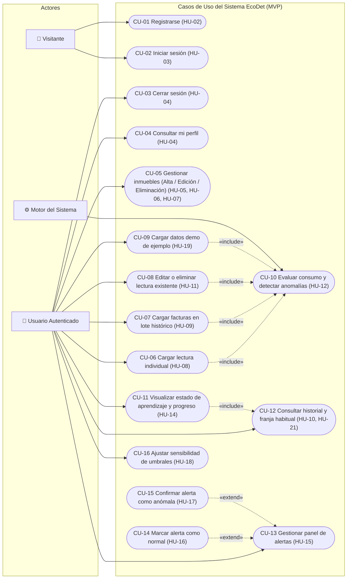

# Diagrama de Casos de Uso Refinado · EcoDet
## Release 1 (MVP) · Consolidado Final de Sprints 1 y 2

**Cátedra:** Taller de Tecnología Aplicada (EGI)  
**Proyecto:** EcoDet — Detector de anomalías en consumo del hogar  
**Versión:** 2.0 (Refinada tras Sprint 2)  
**Insumo:** Product Backlog completo (HU-01 a HU-21) y Reglas de Negocio (RN-01 a RN-17)

---

## 1. Diagrama General de Casos de Uso (Mermaid)

---

## 2. Descripción Detallada de Casos de Uso Refinados

| ID | Caso de Uso | Actor Principal | Historias Asociadas | Descripción y Reglas de Negocio |
| :--- | :--- | :--- | :--- | :--- |
| **CU-01** | Registrarse | Visitante | HU-02 (DET-10) | Permite crear una cuenta nueva con nombre, correo único y contraseña cifrada con `bcrypt` (RN-01, RN-15). |
| **CU-02** | Iniciar sesión | Visitante | HU-03 (DET-11) | Valida credenciales y emite un token JWT con expiración configurable (RN-15). |
| **CU-03** | Cerrar sesión | Usuario | HU-04 (DET-12) | Revoca el token en el cliente y redirige a la pantalla pública de bienvenida. |
| **CU-04** | Consultar perfil | Usuario | HU-04 (DET-12) | Obtiene los datos del usuario logueado mediante `GET /api/auth/me`. |
| **CU-05** | Gestionar inmuebles | Usuario | HU-05, HU-06, HU-07 (DET-13, 14, 15) | Alta, edición de nombre/dirección y **eliminación con borrado en cascada** de lecturas y alertas vinculadas. |
| **CU-06** | Cargar lectura individual | Usuario | HU-08 (DET-16) | Registra una lectura con fecha de inicio, fin y consumo en unidad física (kWh/m³). Prorratea el consumo por día (RN-02, RN-03). Dispara CU-10. |
| **CU-07** | Carga histórica en lote | Usuario | HU-09 (DET-17) | Permite ingresar múltiples facturas pasadas en una sola operación atómica (todo-o-nada). Dispara CU-10. |
| **CU-08** | Editar o eliminar lectura | Usuario | HU-11 (DET-19) | Modifica fechas/consumo o suprime una lectura. Reevalúa inmediatamente la alerta asociada (RN-17). Dispara CU-10. |
| **CU-09** | Cargar datos demo | Usuario | HU-19 (DET-27) | Pobla el inmueble con facturas de prueba y curvas estacionales para evaluación del sistema. |
| **CU-10** | Detectar anomalías | Sistema | HU-12, HU-13 (DET-20, 21) | Motor estadístico: verifica si hay $\ge 6$ lecturas (RN-07), calcula estacionalidad (RN-08), límites $\mu \pm (k \times \sigma)$ (RN-09/10), aplica piso del 10% (RN-12) y emite alertas ALTA/BAJA en estado PENDIENTE. |
| **CU-11** | Ver estado de aprendizaje | Usuario | HU-14 (DET-22) | Muestra si el detector está aprendiendo ($< 6$ lecturas), indicando exactamente cuántas facturas faltan mediante barra de progreso interactiva. |
| **CU-12** | Consultar historial y franja | Usuario | HU-10, HU-21 (DET-18, 29) | Gráficos Chart.js interactivos por servicio con tooltips y sombreado de la franja de consumo habitual entre límite inferior y superior. |
| **CU-13** | Gestionar panel de alertas | Usuario | HU-15 (DET-23) | Muestra la lista de alertas pendientes/resueltas con filtros por servicio y estado, indicando el desvío porcentual. |
| **CU-14** | Marcar alerta como normal | Usuario | HU-16 (DET-24) | El usuario indica que el consumo atípico tuvo causa justificada. Cambia estado a `NORMAL` y se **excluye de cálculos futuros** (RN-11). |
| **CU-15** | Confirmar alerta | Usuario | HU-17 (DET-25) | El usuario confirma que la anomalía fue una pérdida o fuga real. Cambia estado a `CONFIRMADA`. |
| **CU-16** | Ajustar sensibilidad | Usuario | HU-18 (DET-26) | Permite modificar el umbral $k$ de desvíos estándar (entre 1.0 y 3.0) de forma independiente por inmueble y servicio. |
