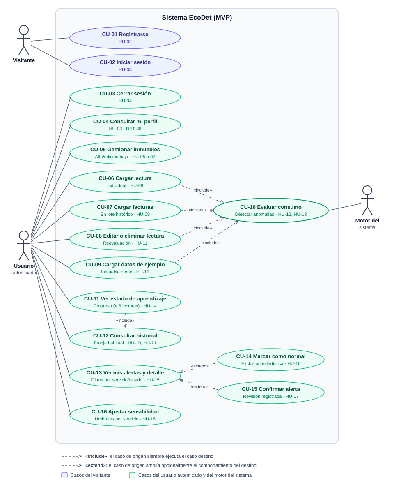

# Diagrama de Casos de Uso Refinado · EcoDet
## Release 1 (MVP) · Consolidado Final de Sprints 1 y 2

**Cátedra:** Taller de Tecnología Aplicada (EGI)  
**Proyecto:** EcoDet — Detector de anomalías en consumo del hogar  
**Versión:** 2.1 (Sincronizada con el código y el catálogo oficial de reglas de negocio)  
**Insumo:** Product Backlog completo (HU-01 a HU-21) y Reglas de Negocio (`docs/producto/03-documentacion-de-apoyo.md`)

---

## 1. Diagrama General de Casos de Uso (UML)

---

## 2. Descripción Detallada de Casos de Uso Refinados

| ID | Caso de Uso | Actor Principal | Historias Asociadas | CU oficial | Descripción y Reglas de Negocio |
| :--- | :--- | :--- | :--- | :---: | :--- |
| **CU-01** | Registrarse | Visitante | HU-02 (DET-10) | CU-01 | Crea una cuenta con nombre, correo único y contraseña de al menos 8 caracteres con letras y números, guardada con hash `bcrypt` (RN-15). La cuenta nueva no ve datos de otros usuarios (RN-01). |
| **CU-02** | Iniciar sesión | Visitante | HU-03 (DET-11) | CU-02 | Valida credenciales y emite un token JWT. Ante credenciales incorrectas responde con un error genérico (RN-01, RN-19). |
| **CU-03** | Cerrar sesión | Usuario | HU-04 (DET-12) | CU-10 | Elimina el token en el cliente y vuelve a la pantalla de acceso. |
| **CU-04** | Consultar perfil | Usuario | HU-03 (DET-38) | — | Obtiene los datos del usuario autenticado mediante `GET /api/auth/me`. Es soporte técnico de CU-02. |
| **CU-05** | Gestionar inmuebles | Usuario | HU-05, HU-06, HU-07 (DET-13, 14, 15) | CU-03 | Alta, edición de nombre y dirección, y eliminación con confirmación. Eliminar un inmueble borra sus lecturas, alertas y umbrales (RN-18). |
| **CU-06** | Cargar lectura individual | Usuario | HU-08 (DET-16) | CU-04 | Registra una lectura con fecha de inicio, fecha de fin y consumo físico (kWh o m³). Valida fechas (RN-03), valor >= 0 (RN-05), unidad física (RN-02) y ausencia de superposición (RN-14). Calcula el consumo por día (RN-06) y dispara CU-10. |
| **CU-07** | Carga histórica en lote | Usuario | HU-09 (DET-17) | CU-04 (lote) | Ingresa varias facturas pasadas en una sola operación atómica (todo o nada), validando también la superposición dentro del lote (RN-14). Dispara CU-10. |
| **CU-08** | Editar o eliminar lectura | Usuario | HU-11 (DET-19) | CU-09 | Modifica o elimina una lectura con las mismas validaciones que la carga. La lectura editada se vuelve a evaluar y su alerta se reemplaza; las alertas de otras lecturas no se recalculan (RN-17). |
| **CU-09** | Cargar datos de ejemplo | Usuario | HU-19 (DET-27) | CU-08 | Crea un inmueble de demostración con 24 meses de luz y gas y 12 de agua, con 2 anomalías altas y 1 baja por servicio. Solo se permite uno por usuario (RN-16). |
| **CU-10** | Evaluar consumo y detectar anomalías | Sistema | HU-12, HU-13 (DET-20, 21) | CU-06 | Motor estadístico: exige 6 lecturas por servicio (RN-07), elige referencia estacional o general (RN-08), calcula límites promedio ± umbral × desvío efectivo (RN-09, RN-12), clasifica en alta o baja (RN-10, RN-20) y genera la alerta en estado Pendiente (RN-13). |
| **CU-11** | Ver estado de aprendizaje | Usuario | HU-14 (DET-22) | CU-06 / CU-04 | Con menos de 6 lecturas no se generan alertas: se muestra "aún estamos aprendiendo tu patrón", cuántas lecturas faltan y una barra de progreso (RN-07). |
| **CU-12** | Consultar historial y franja habitual | Usuario | HU-10, HU-21 (DET-18, 29) | CU-05 | Gráfico por servicio con detalle al seleccionar un punto. Resalta las lecturas con alerta. Permite mostrar u ocultar la franja habitual cuando el detector está activo. |
| **CU-13** | Ver mis alertas y su detalle | Usuario | HU-15 (DET-23) | CU-07 | Lista las alertas de un inmueble con servicio, período, tipo, desvío y estado, con filtros por servicio y estado. |
| **CU-14** | Marcar alerta como normal | Usuario | HU-16 (DET-24) | CU-07 | Pide confirmación y cambia el estado a `NORMAL`. La lectura queda fuera del promedio y del desvío en las detecciones siguientes (RN-11, RN-13, RN-17). |
| **CU-15** | Confirmar alerta | Usuario | HU-17 (DET-25) | CU-07 | Cambia el estado a `CONFIRMADA`: deja registrado que el usuario ya la revisó. No modifica el cálculo del detector (RN-13). |
| **CU-16** | Ajustar sensibilidad | Usuario | HU-18 (DET-26) | CU-07 | Permite cambiar el umbral (cantidad de desvíos) de cada servicio y cada inmueble. Acepta cualquier número mayor que cero; el valor inicial es 2. Aplica solo a detecciones futuras (RN-09, RN-17). |
