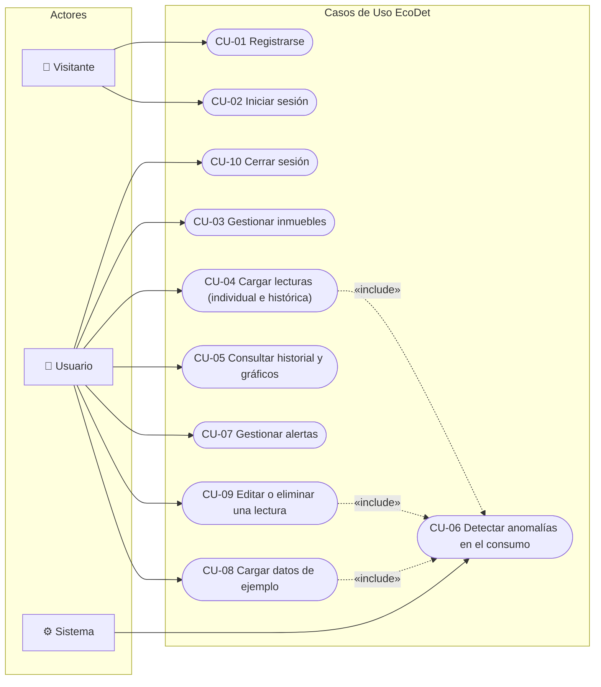

# Diagrama de Casos de Uso · EcoDet
**Sprint 1 · Actividad A5** · Insumo: Secciones 2 y 4 de la Documentación de Apoyo

---

## Actores y Casos de Uso

### Relaciones clave:
- El **Visitante** pasa a ser **Usuario** al registrarse (CU-01) o iniciar sesión (CU-02).
- La carga de lecturas (CU-04), carga de datos demo (CU-08) y la edición de lecturas (CU-09) disparan automáticamente el motor de detección de anomalías del **Sistema** (CU-06).
