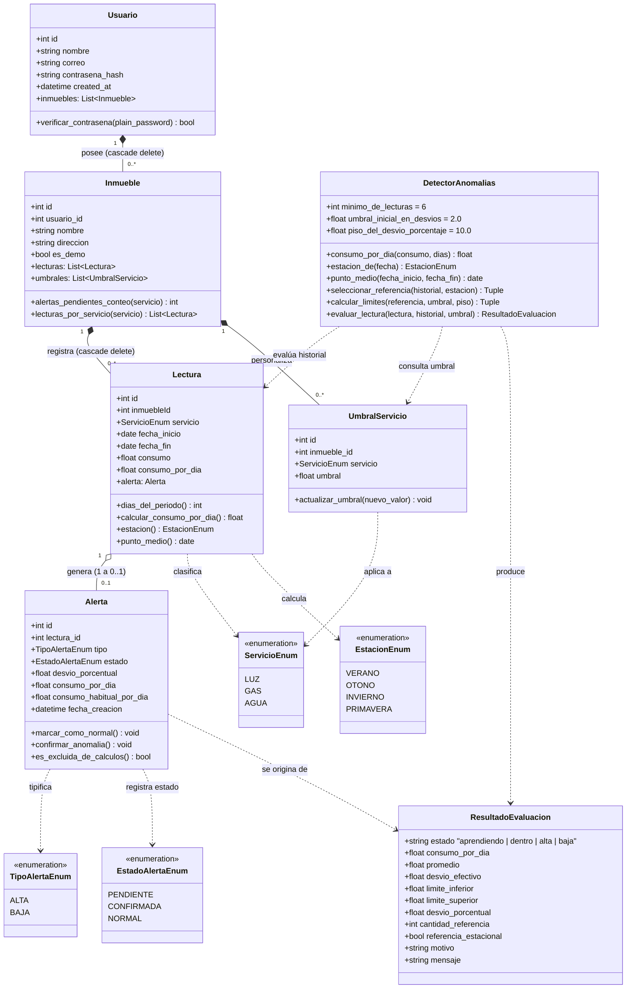

# Diagrama de Clases del Dominio Refinado · EcoDet
## Release 1 (MVP) · Consolidado Final de Sprints 1 y 2

**Cátedra:** Taller de Tecnología Aplicada (EGI)  
**Proyecto:** EcoDet — Detector de anomalías en consumo del hogar  
**Versión:** 2.0 (Refinada tras Sprint 2)  
**Insumo:** Modelos SQLAlchemy (`backend/app/models.py`), Esquemas Pydantic (`schemas.py`), Lógica del Detector (`detector.py`) y Reglas de Negocio (RN-01 a RN-17).

---

## 1. Diagrama de Clases del Dominio (Mermaid)

---

## 2. Descripción de Clases, Responsabilidades y Métodos

### 2.1. `Usuario`
- **Responsabilidad:** Representa la cuenta autenticable en el sistema.
- **Seguridad:** No almacena contraseñas en texto plano; guarda únicamente `contrasena_hash` generado con salt individual mediante `bcrypt` (RN-01, RN-15).
- **Relaciones:** Posee una colección de `Inmuebles`. Al eliminarse el usuario, se eliminan sus inmuebles por cascada.

### 2.2. `Inmueble`
- **Responsabilidad:** Unidad física donde se miden los servicios (casa, departamento, comercio).
- **Campos:** `nombre`, `direccion`, `es_demo` (identifica cuentas de ejemplo preconfiguradas).
- **Regla en cascada:** Su eliminación elimina automáticamente todas las lecturas y alertas hijas (HU-07 / RN-16).
- **Métodos:**
  - `alertas_pendientes_conteo(servicio)`: Calcula la cantidad de anomalías no resueltas para los badges de la UI (HU-15).
  - `lecturas_por_servicio(servicio)`: Filtra y ordena cronológicamente las facturas del inmueble.

### 2.3. `Lectura`
- **Responsabilidad:** Registra el consumo medido entre dos fechas para un servicio determinado.
- **Unidades Físicas (RN-02):** kWh para Luz, m³ para Gas y Agua (nunca importes en dinero).
- **Métodos de Negocio:**
  - `dias_del_periodo()`: Diferencia en días entre `fecha_fin` y `fecha_inicio` (debe ser $\ge 1$).
  - `calcular_consumo_por_dia()`: Prorratea el consumo: $\frac{\text{consumo}}{\text{dias}}$ (RN-03).
  - `punto_medio()`: Calcula la fecha media del período para determinar la estación climática representativa.
  - `estacion()`: Devuelve `VERANO`, `OTONO`, `INVIERNO` o `PRIMAVERA` según las fechas astronómicas de Argentina (RN-08).

### 2.4. `Alerta`
- **Responsabilidad:** Entidad persistida cuando una lectura evaluada resulta anómala (`ALTA` o `BAJA`).
- **Estados de Ciclo de Vida:**
  - `PENDIENTE`: Estado inicial al ser detectada la anomalía.
  - `NORMAL`: El usuario indica que el consumo atípico tuvo motivo justificado (pileta, invitados, estufa). **Efecto clave:** La lectura asociada se excluye de los cálculos futuros para no contaminar la media habitual (RN-11, RN-17).
  - `CONFIRMADA`: El usuario valida que se trató de una fuga, pérdida o problema real (HU-17).

### 2.5. `UmbralServicio`
- **Responsabilidad:** Permite al usuario ajustar la sensibilidad del detector por servicio e inmueble (HU-18).
- **Comportamiento:** Si no existe configuración particular, se aplica el valor global por defecto ($k = 2.0$ desvíos estándar según RN-09). Valores admitidos: $1.0 \le k \le 3.0$.

### 2.6. `DetectorAnomalias` (Lógica del Dominio)
- **Responsabilidad:** Módulo de funciones puras e independientes de base de datos (`detector.py`) que implementa el algoritmo estadístico de detección:
  1. **Condición de aprendizaje:** Si el historial tiene menos de 6 lecturas, devuelve `estado = "aprendiendo"` e indica las lecturas faltantes (RN-07).
  2. **Selección de referencia:** Si existen $\ge 2$ lecturas de la misma estación, usa la referencia estacional; de lo contrario, usa el historial general (RN-08).
  3. **Exclusión de normales:** Ignora lecturas con alertas marcadas como `NORMAL` (RN-11).
  4. **Cálculo de límites:** 
     $$\text{Límite Superior} = \mu + (k \times \sigma)$$
     $$\text{Límite Inferior} = \mu - (k \times \sigma)$$
  5. **Piso de desvío (RN-12):** Si $\sigma < 0.10 \times \mu$, se fuerza $\sigma = 0.10 \times \mu$ para evitar alarmas falsas ante consumos planos.
  6. **Clasificación:** Devuelve `ResultadoEvaluacion` con estado `alta`, `baja` o `dentro`.
