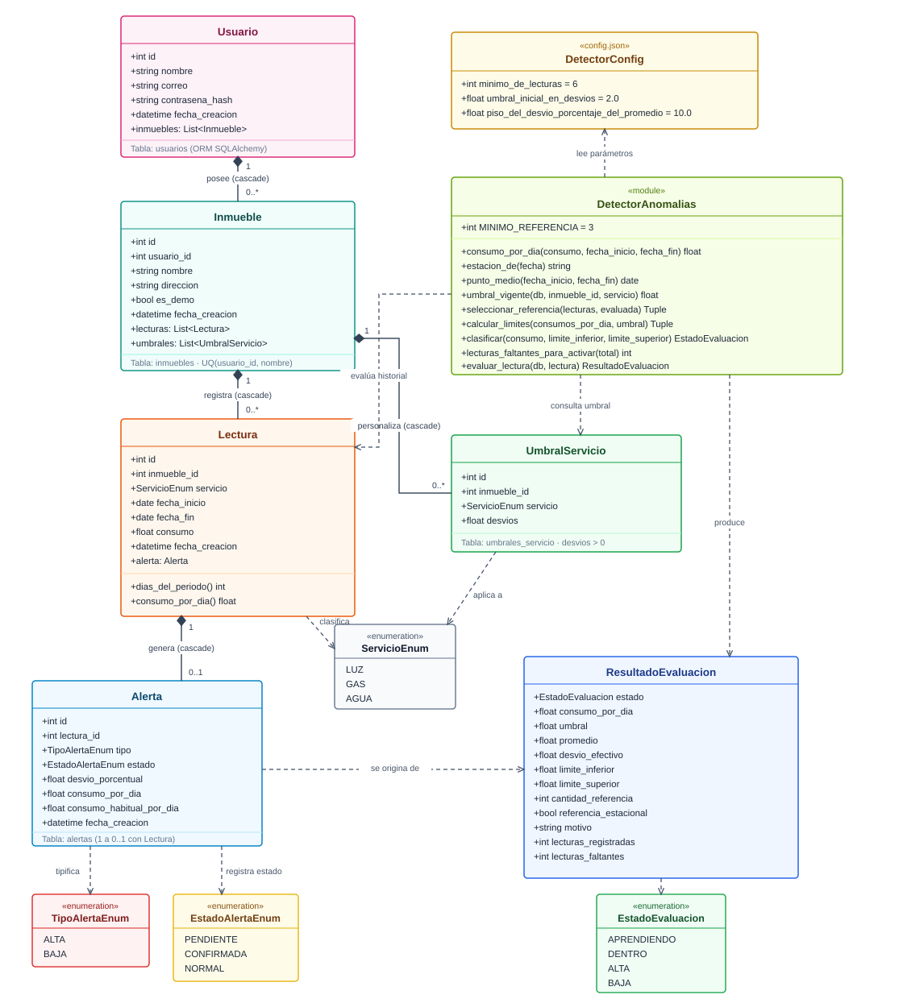

# Diagrama de Clases del Dominio Refinado · EcoDet
## Release 1 (MVP) · Consolidado Final de Sprints 1 y 2

**Cátedra:** Taller de Tecnología Aplicada (EGI)  
**Proyecto:** EcoDet — Detector de anomalías en consumo del hogar  
**Versión:** 2.1 (Sincronizada con `backend/app/models.py`, `backend/app/services/detector.py` y `backend/config.json`)

---

## 1. Diagrama de Clases del Dominio (UML)

---

## 2. Descripción de Clases, Responsabilidades y Métodos

### 2.1. `Usuario`
- **Responsabilidad:** Representa la cuenta autenticable en el sistema.
- **Seguridad:** No almacena contraseñas en texto plano; guarda únicamente `contrasena_hash` generado con `bcrypt` (RN-15).
- **Relaciones:** Posee una colección de `Inmuebles`. El modelo define borrado en cascada; el MVP no incluye baja de cuenta.

### 2.2. `Inmueble`
- **Responsabilidad:** Unidad física donde se miden los servicios (casa, departamento, comercio).
- **Campos:** `nombre` (único por usuario), `direccion` (opcional), `es_demo` y `fecha_creacion`.
- **Regla en cascada:** Su eliminación borra automáticamente sus lecturas, umbrales y alertas hijas (HU-07, RN-18).

### 2.3. `Lectura`
- **Responsabilidad:** Registra el consumo medido entre dos fechas para un servicio determinado (`LUZ`, `GAS`, `AGUA`).
- **Unidades físicas (RN-02):** kWh para Luz, m³ para Gas y Agua (nunca importes en dinero).
- **Cálculos del modelo:**
  - `dias_del_periodo()`: cuenta inclusiva, `fecha_fin − fecha_inicio + 1`.
  - `consumo_por_dia()`: consumo dividido por los días del período (RN-06).

### 2.4. `Alerta`
- **Responsabilidad:** Entidad persistida cuando una lectura evaluada resulta anómala (`ALTA` o `BAJA`).
- **Estados de ciclo de vida (RN-13):**
  - `PENDIENTE`: estado inicial al detectarse la anomalía.
  - `NORMAL`: el usuario justifica el consumo atípico; la lectura se excluye de cálculos futuros (RN-11, RN-17).
  - `CONFIRMADA`: el usuario confirma la anomalía revisada; no altera cálculos del detector.

### 2.5. `UmbralServicio`
- **Responsabilidad:** Guarda la sensibilidad (`desvios > 0`) configurada para un servicio e inmueble (HU-18).
- **Valor por defecto:** 2.0 desvíos estándar según `backend/config.json` (RN-09).

### 2.6. `DetectorAnomalias` y `DetectorConfig`
- **Responsabilidad:** Módulo `backend/app/services/detector.py` con funciones puras independientes de la base de datos y configuración externa en `backend/config.json`:
  1. **Aprendizaje (RN-07):** requiere 6 lecturas del servicio y al menos 3 de referencia válidas.
  2. **Estacionalidad (RN-08):** asigna la estación meteorológica del hemisferio sur según el punto medio del período (Verano dic–feb, Otoño mar–may, Invierno jun–ago, Primavera sep–nov). Usa referencia estacional si hay >= 3 lecturas de esa estación.
  3. **Exclusión (RN-11):** excluye la lectura evaluada y las marcadas `NORMAL`.
  4. **Límites (RN-09, RN-12):** promedio simple y desvío estándar muestral `(n-1)`, con piso del 10 % del promedio.
  5. **Clasificación (RN-10, RN-20):** produce `ResultadoEvaluacion` con `EstadoEvaluacion` (`APRENDIENDO`, `DENTRO`, `ALTA`, `BAJA`).
