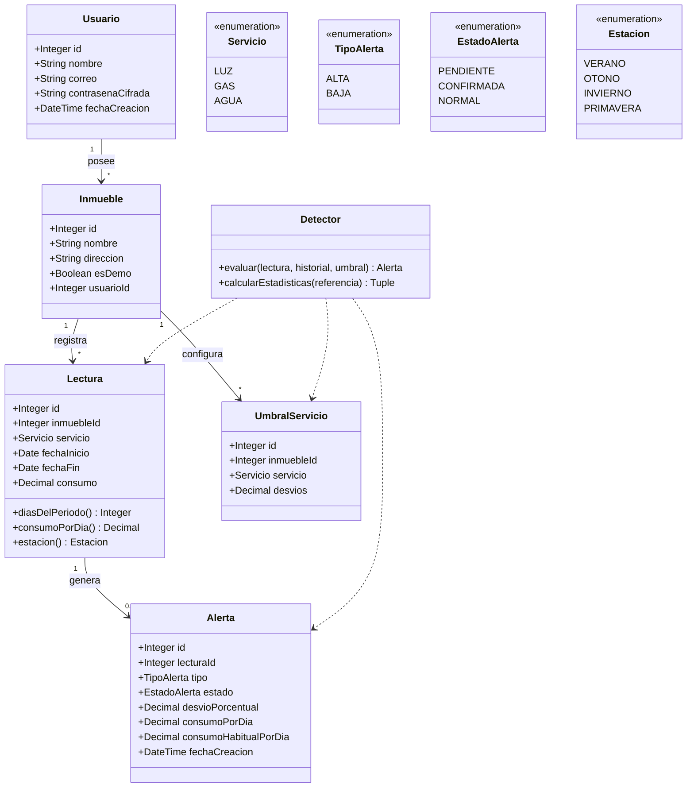

# Diagrama de Clases del Dominio · EcoDet
**Sprint 1 · Actividad A6** · Insumo: Reglas de Negocio RN-01 a RN-17 y Criterios HU-01 a HU-21

---

## Diagrama de Clases (Mermaid)

---

## Respuestas a las Preguntas de Modelado (Sección 3.2 de la Guía)

1. **¿Cada lectura tiene como máximo una alerta?**
   - **Sí.** Relación `1` a `0..1`. Cada lectura evaluada genera a lo sumo una alerta (alta o baja). Si la lectura se edita, se reemplaza la alerta anterior asociada.
2. **¿El umbral se crea al crear el inmueble o se usa el valor de configuración hasta que cambie?**
   - **Se usa el valor de configuración global (`2.0`)** hasta que el usuario decida personalizarlo en la base de datos (tabla `UmbralServicio`). Esto evita filas redundantes vacías.
3. **¿La estación y el consumo por día se guardan o se calculan?**
   - **Se calculan dinámicamente** mediante métodos de la entidad `Lectura` (`consumoPorDia()` y `estacion()`), ya que dependen de fórmulas deterministas sobre las fechas y el consumo. En la tabla `Alerta` sí se guarda el consumo por día al momento de la detección para congelar el valor histórico.
4. **¿Los parámetros del sistema son clase de dominio o configuración?**
   - **Son configuración** (`config.json` / `pydantic-settings`). Los parámetros globales (mínimo de lecturas 6, umbral inicial 2, piso de desvío 10%) los gestiona el sistema fuera del código y no son editables por el usuario final.
