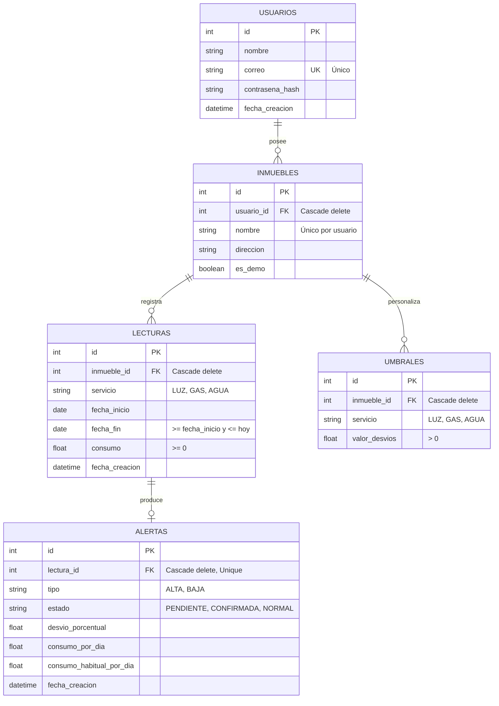

# Modelo de Datos Relacional (ER) · EcoDet
**Sprint 1 · Actividad A6** · Motor: SQLite / SQLAlchemy

---

## Diagrama Entidad-Relación (Mermaid erDiagram)

---

## Restricciones de Integridad y Reglas del Modelo (Sección 3.3 de la Guía)
1. **Unicidad de Usuario:** `correo` es único a nivel global en la tabla `USUARIOS`.
2. **Unicidad de Inmueble:** `(usuario_id, nombre)` es único (no se permite que el mismo usuario tenga dos inmuebles con el mismo nombre).
3. **No superposición de lecturas:** En `LECTURAS`, no se permiten períodos superpuestos para el mismo `(inmueble_id, servicio)`.
4. **Validación de consumo y fechas:** `consumo >= 0`, `fecha_fin >= fecha_inicio` y `fecha_fin <= CURRENT_DATE`.
5. **Borrado en cascada:** Al eliminar un inmueble, se eliminan automáticamente sus lecturas, umbrales y alertas asociadas (`ON DELETE CASCADE`).
