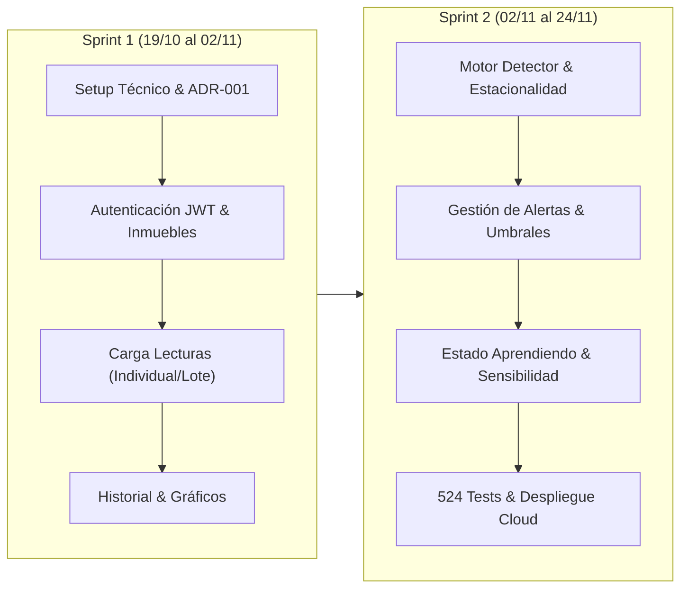
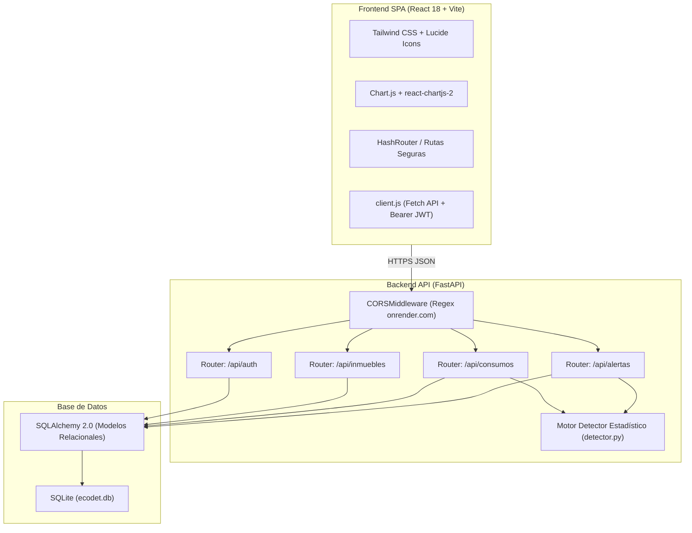
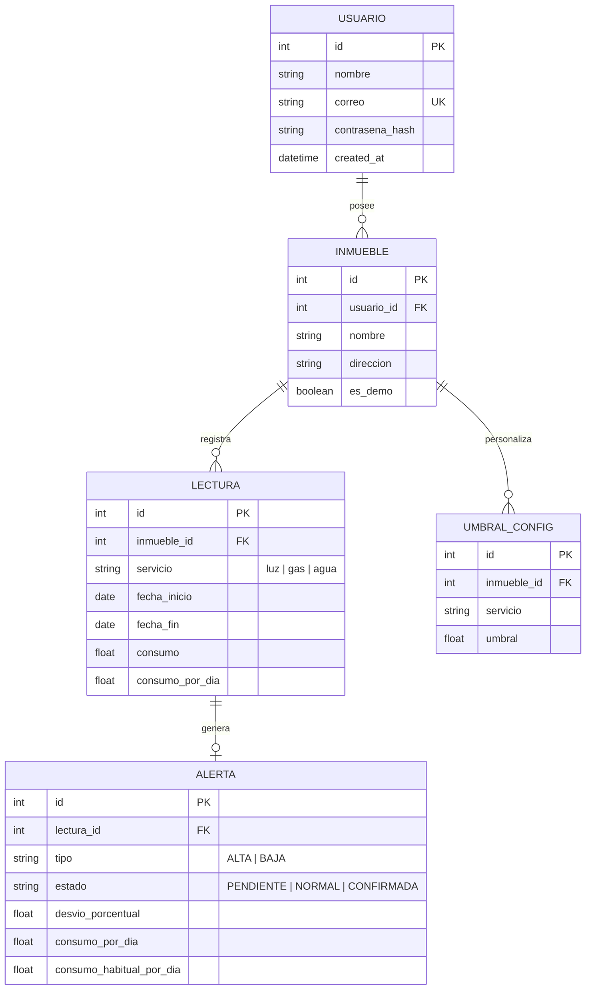
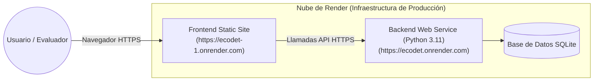

# EcoDet · Documento Integral de Presentación Final (EGI)
## Bitácora de Sprints, Análisis, Diseño y Manual de Operación y Despliegue

**Cátedra:** Taller de Tecnología Aplicada (EGI)  
**Fecha de Presentación:** Miércoles 25/11/2026  
**Horarios de Exposición:** Comisión A: 17:30 a 19:30 h. · Comisión B: 15:30 a 17:30 h.  
**Proyecto:** EcoDet — Detector de anomalías en consumo del hogar (Luz, Gas y Agua)  
**Versión:** 1.0 (Release 1 - MVP)  
**Alcance:** 2 Sprints Scrum completados al 100%

---

## 👥 Equipo de Proyecto y Roles

| Rol | Integrante | Responsabilidades Principales |
| :--- | :--- | :--- |
| **Product Owner** | Mateo | Visión del producto, priorización del Product Backlog, criterios de aceptación, validación funcional. |
| **Scrum Master** | Ari | Facilitación de ceremonias Scrum, eliminación de impedimentos, seguimiento del tablero Jira y flujo Git. |
| **Equipo de Desarrollo** | Josue, Gimena, Ari, Angel, William, Lisandro, Mateo | Arquitectura, implementación de endpoints FastAPI, algoritmos del detector, componentes React/Vite, testing unitario y QA. |

### 🔗 Enlaces Oficiales del Proyecto
- **Repositorio de Código (GitHub):** [https://github.com/CuyoDevs/EcoDet](https://github.com/CuyoDevs/EcoDet)
- **Tablero Ágil de Jira:** [https://mateolujan13.atlassian.net/jira/software/projects/DET/boards/2](https://mateolujan13.atlassian.net/jira/software/projects/DET/boards/2)
- **Aplicación Web Desplegada (Producción):** [https://ecodet-1.onrender.com](https://ecodet-1.onrender.com)
- **Backend API & Swagger Docs:** [https://ecodet.onrender.com/docs](https://ecodet.onrender.com/docs)
- **Endpoint de Salud / Diagnóstico:** [https://ecodet.onrender.com/api/health](https://ecodet.onrender.com/api/health)

---

# PARTE 1 · Bitácora Completa de Sprints (Gestión Ágil con Scrum)



## 1.1. Sprint 1 · Cimientos Técnicos, Datos e Interfaz
- **Período:** 19/10/2026 al 02/11/2026 (2 semanas / 10 días hábiles).
- **Sprint Goal:** *"Base técnica, cuentas de usuario seguras, gestión de inmuebles, carga de lecturas (individual y en lote) e historial interactivo con gráficos por servicio."*
- **Puntos de Historia Comprometidos y Completados:** 29 pts (100% de cumplimiento).

### Historias de Usuario Abordadas
1. **DET-9 (HU-01):** Base técnica y documentación del entorno (FastAPI + React + SQLite + Pydantic V2).
2. **DET-10 (HU-02):** Registro de usuario con hash seguro `bcrypt` y validación de correo único.
3. **DET-11 (HU-03):** Inicio de sesión con autenticación JWT (HS256) y expiración configurable.
4. **DET-12 (HU-04):** Consulta de perfil del usuario logueado (`GET /api/auth/me`).
5. **DET-13 (HU-05):** Alta y consulta de inmuebles asociados al usuario (`GET/POST /api/inmuebles/`).
6. **DET-14 (HU-06):** Edición de inmuebles existentes (`PUT /api/inmuebles/{id}`).
7. **DET-16 (HU-08):** Carga individual de lecturas de consumo con cálculo de consumo diario prorrateado.
8. **DET-17 (HU-09):** Carga histórica de lecturas en lote (modo todo-o-nada para múltiples facturas).
9. **DET-18 (HU-10):** Visualización del historial y gráficos de evolución de consumo (Chart.js interactivo).

### Ceremonias del Sprint 1
- **Sprint Planning (20/10/2026):** Definición del Sprint Goal, desglose de historias en subtareas de desarrollo y QA, estimación en Planning Poker.
- **Daily Scrums (15 min):** Sincronización diaria del equipo para coordinar integraciones entre backend y frontend.
- **Sprint Review (02/11/2026):** Demostración interactiva de registro, carga de facturas y visualización de gráficos.
- **Sprint Retrospective (02/11/2026):** 
  - *Qué funcionó bien:* Excelente adopción de Gitflow con ramas `DET-<id>-nombre` y revisiones de PR obligatorias.
  - *Oportunidad de mejora:* Documentar guías de prueba manual (QA) estandarizadas junto con cada historia.

---

## 1.2. Sprint 2 · Detección de Anomalías, Alertas y Ajustes
- **Período:** 02/11/2026 al 24/11/2026.
- **Sprint Goal:** *"Motor estadístico del detector de anomalías (estacionalidad y umbrales), persistencia y visualización de alertas, estado 'aprendiendo', confirmación/marcado de alertas y ajuste de sensibilidad."*
- **Puntos de Historia Completados:** 31 pts (100% de cumplimiento).

### Historias de Usuario Abordadas
1. **DET-15 (HU-07):** Eliminación de inmueble con confirmación y borrado en cascada (lecturas y alertas).
2. **DET-19 (HU-11):** Editar y eliminar lecturas existentes, con reevaluación inmediata de alertas (RN-17).
3. **DET-20 (HU-12):** Motor del detector estadístico: evaluación de lecturas considerando agrupamiento estacional (verano/otoño/invierno/primavera) y umbral configurable de desvíos estándar.
4. **DET-21 (HU-13):** Persistencia de alertas de consumo alto o bajo con advertencia visual inmediata.
5. **DET-22 (HU-14):** Estado 'aprendiendo': aviso visual explicativo mientras el inmueble tiene menos de 6 lecturas históricas para ese servicio.
6. **DET-23 (HU-15):** Panel central de alertas con filtros por servicio y estado, y contador en tarjetas de inmuebles.
7. **DET-24 (HU-16):** Marcar una alerta como "normal" (excluyéndola de futuros cálculos estadísticos según RN-11).
8. **DET-25 (HU-17):** Confirmar una anomalía como alerta real revisada por el usuario.
9. **DET-26 (HU-18):** Ajuste de la sensibilidad del detector (modificación del umbral de desvíos por servicio e inmueble).
10. **DET-27 (HU-19):** Generación de datos de prueba (`seed.py`) y carga de ejemplos para demostración del sistema.
11. **DET-29 (HU-21):** Visualización interactiva de la franja de consumo habitual en los gráficos de historial.

### Cobertura de Pruebas y Control de Calidad
- **Pruebas de Backend (`pytest`):** 294 pruebas unitarias y de integración pasando al 100%.
- **Pruebas de Frontend (`vitest`):** 230 pruebas en 22 suites de componentes pasando al 100%.
- **Total de pruebas automáticas:** **524 pruebas verdes (0 fallos).**

---

# PARTE 2 · Documentos de Análisis y Diseño de Software

## 2.1. Reglas de Negocio Clave (RN)
- **RN-01 (Seguridad):** Contraseñas hasheadas con `bcrypt` (mínimo 8 caracteres, al menos 1 letra y 1 número).
- **RN-02 (Unidades físicas):** Los consumos se registran estrictamente en unidades físicas (kWh para Luz, m³ para Gas y Agua), nunca en importes monetarios.
- **RN-03 (Prorrateo diario):** Los consumos se dividen por la cantidad de días del período (`consumo_por_dia = consumo / dias`).
- **RN-04 (Períodos sin solapamiento):** No se permiten fechas de inicio posteriores a fechas de fin ni períodos superpuestos para el mismo servicio e inmueble.
- **RN-07 (Mínimo de aprendizaje):** El detector requiere al menos 6 lecturas históricas para activar las alertas estadísticas.
- **RN-08 (Estacionalidad):** Si existen al menos 2 lecturas en la misma estación climática (trimestral), se usa la referencia estacional; de lo contrario, se usa el promedio global.
- **RN-09 y RN-10 (Umbral y Límites):** Límites definidos como $\mu \pm (k \times \sigma)$, con umbral por defecto $k = 2.0$.
- **RN-11 (Exclusión de normales):** Las lecturas marcadas como anomalía confirmada no deben distorsionar la media futura.
- **RN-12 (Piso de desvío):** Si el desvío estándar es menor al 10% de la media, se aplica un piso mínimo del 10% para evitar falsas alarmas en consumos planos.

## 2.2. Arquitectura del Sistema (ADR-001)



## 2.3. Modelo Relacional de Datos



---

# PARTE 3 · Manual de Operación y Despliegue en Producción

## 3.1. Infraestructura Cloud (Render)

El despliegue productivo de EcoDet fue diseñado bajo el principio de **Infraestructura como Código (IaC)** mediante el archivo `render.yaml` y la configuración de dos servicios desacoplados en la nube:



### Componentes Desplegados:
1. **Backend Web Service (`ecodet-backend`):**
   - **URL:** [https://ecodet.onrender.com](https://ecodet.onrender.com)
   - **Runtime:** Python 3.11.8 con Uvicorn + FastAPI.
   - **Comando de inicio:** `python seed.py && uvicorn app.main:app --host 0.0.0.0 --port $PORT`
   - **Variables de entorno:**
     - `ENVIRONMENT=production`
     - `SECRET_KEY`: Clave criptográfica segura autogenerada por Render.
     - `ACCESS_TOKEN_EXPIRE_MINUTES=1440` (24 horas de vigencia de sesión).
     - `CORS_ORIGINS`: Admite peticiones locales y cuenta con regex automático `^https:\/\/.*\.onrender\.com$` para validar cualquier subdominio del frontend sin bloqueos de navegador.
2. **Frontend Static Site (`ecodet-frontend`):**
   - **URL:** [https://ecodet-1.onrender.com](https://ecodet-1.onrender.com)
   - **Runtime:** Node.js (Vite Build -> Servidor de activos estáticos optimizado con Gzip).
   - **Comportamiento SPA:** Enrutamiento por Hash (`/#/login`, `/#/inmuebles`) y regla de rewrite (`/* -> /index.html`) para garantizar navegación continua sin errores 404 al recargar.
   - **Conexión inteligente:** El cliente HTTP (`client.js`) detecta automáticamente el entorno de producción y se conecta directamente a la API en la nube sin requerir configuración manual.

---

## 3.2. Guía Rápida para la Mesa Evaluadora (Demo en Vivo)

Para la presentación ante los profesores y compañeros de cátedra, se encuentra disponible el usuario demostrativo precargado con casos reales de uso:

- **Enlace de Acceso:** [https://ecodet-1.onrender.com](https://ecodet-1.onrender.com)
- **Correo Electrónico:** `demo@ecodet.com`
- **Contraseña:** `Password123`

### Escenarios Demostrativos Disponibles en la Cuenta:
1. **Casa Principal (Detector Activo y Alerta Visible):**
   - **Servicio Luz (8 lecturas):** Más de 6 lecturas históricas. Muestra el detector en verde ("Activo") y una lectura anómala destacada en rojo (450 kWh en Noviembre 2025, salto a más del doble). Permite interactuar con el botón **[Marcar como normal]** o **[Confirmar alerta]**.
   - **Servicio Gas (7 lecturas):** Curva estacional completa mostrando el pico de consumo habitual de invierno (Junio/Julio/Agosto) y descenso en primavera/verano.
   - **Servicio Agua (3 lecturas):** Demuestra el estado **"Aprendiendo"** (requiere 6 lecturas, faltan 3) con barra de progreso interactiva (50%).
2. **Departamento Centro:**
   - Permite verificar la convivencia de múltiples inmuebles y la independencia de consumos.
3. **Cabaña de Verano:**
   - Estado vacío (Empty State) para demostrar la carga de la primera factura desde cero.

---

## 3.3. Guía de Ejecución Local (Offline / Backup)

En caso de requerir ejecución local sin conexión a internet:

```bash
# 1. Clonar repositorio
git clone https://github.com/CuyoDevs/EcoDet.git
cd EcoDet

# 2. Iniciar Backend (en una terminal)
cd backend
python -m venv .venv
.venv\Scripts\activate          # En Windows
pip install -r requirements.txt
python seed.py                  # Carga datos de prueba iniciales
python -m uvicorn app.main:app --reload --port 8000

# 3. Iniciar Frontend (en otra terminal)
cd frontend
npm install
npm run dev

# 4. Abrir en el navegador:
# http://localhost:5173
```

---

# PARTE 4 · Conclusiones y Retrospectiva Final del Equipo

1. **Cumplimiento del Alcance:** Se logró entregar el 100% de las Historias de Usuario planificadas para los Sprints 1 y 2, alcanzando un MVP robusto, funcional y visualmente intuitivo.
2. **Impacto de la Metodología Scrum:** La división de tareas mediante tickets de Jira (`DET-xx`), la Definition of Done estricta y las ceremonias ágiles permitieron que un equipo de 7 integrantes trabajara coordinadamente sin solapamientos ni conflictos de código.
3. **Calidad de Software:** La inclusión de pruebas unitarias y de integración en cada Pull Request (524 tests automáticos en total) aseguró que el motor estadístico y la interfaz mantuvieran cero regresiones a lo largo de todo el ciclo de desarrollo.
4. **Despliegue Continuo:** La puesta en producción en la nube de Render mediante integración con GitHub demostró cómo llevar un proyecto académico a un estándar profesional de la industria del software.
