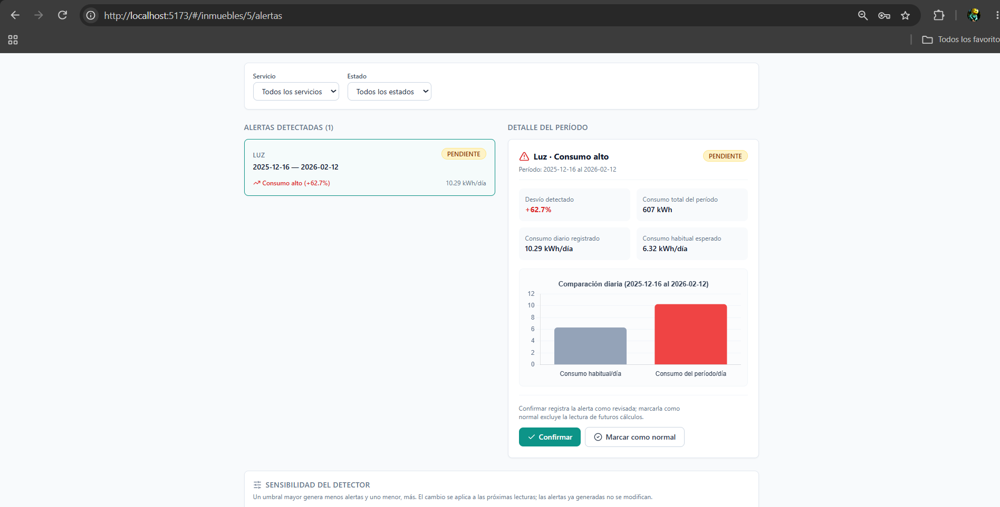
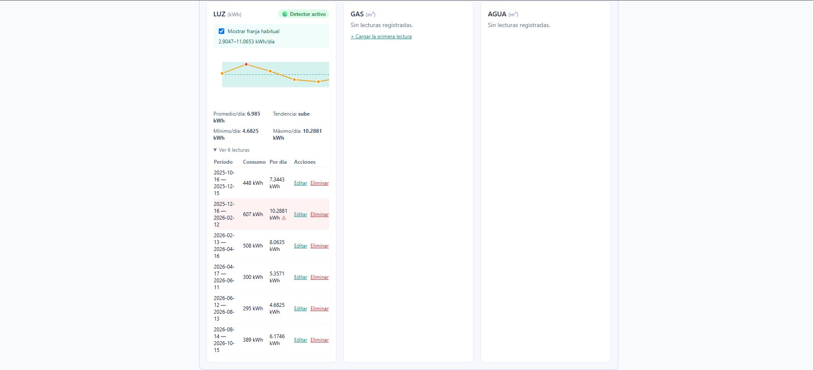
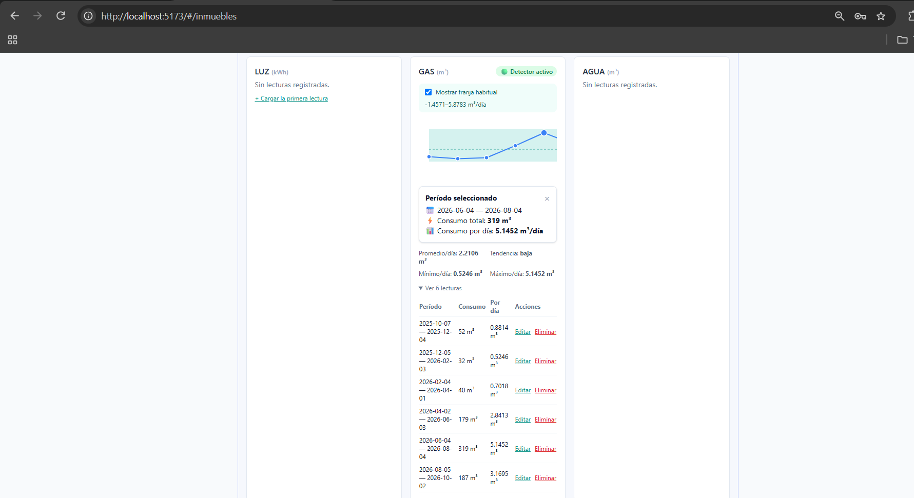
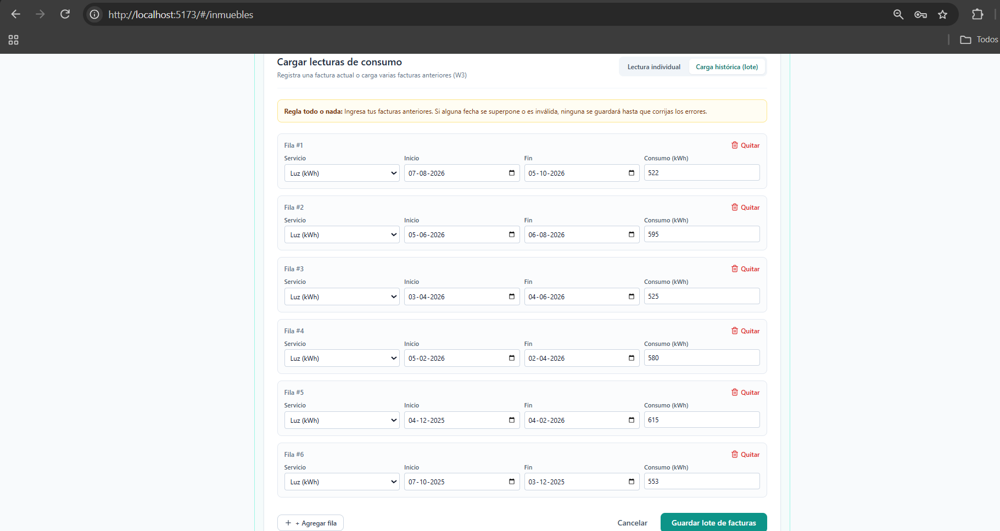
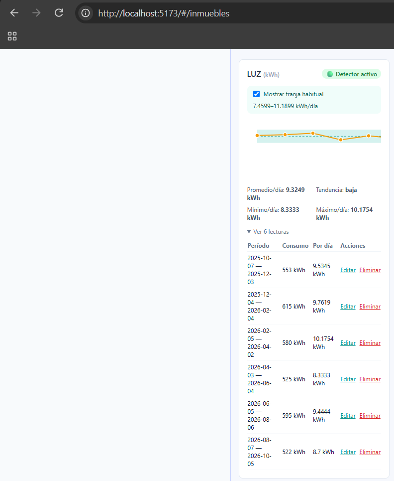

# HU-20 · Probar con usuarios reales

_Registro de resultados por usuario · Épica E7 · Sprint 2_

| **Dato**                                      | **Usuario 1**                                   | **Usuario 2** | **Usuario 3**                                                                          |
|-----------------------------------------------|-------------------------------------------------|---------------|----------------------------------------------------------------------------------------|
| **¿Pudo cargar agua? (sí / con ayuda / no)**  | Sí                                              | Sí            | Con ayuda                                                                              |
| **¿Cuántas facturas cargó? (se necesitan 6)** | 6                                               | 6             | 6                                                                                      |
| **Alertas que le salieron**                   | 1                                               | 0             | 0                                                                                      |
| **Alertas que marcó como “normal”**           | 1                                               | 0             | 0                                                                                      |
| **Opinión sobre la carga (1 a 5)**            | 5                                               | 5             | 5                                                                                      |
| **Opinión sobre los gráficos (1 a 5)**        | 4                                               | 5             | 4                                                                                      |
| **Opinión sobre las alertas (1 a 5)**         | 5                                               | 5             | 5                                                                                      |
| **Comentario libre / dónde se trabó**         | Mejorar el gráfico dando más valores / detalles | —             | Se trabo y pidió ayuda al cargar las facturas con las fechas que salían en la factura. |

---

## Anexo · Evidencia por usuario

_Capturas de pantalla de las pruebas_

### Usuario 1 · Luz

*Alerta detectada en Luz: consumo alto (+62,7 %), pendiente de revisión.*

*Las 6 facturas de Luz cargadas; el período con la alerta aparece resaltado.*

### Usuario 2 · Gas

*Las 6 facturas de Gas cargadas; el detector está activo y no generó alertas.*

### Usuario 3 · Luz

*Carga de las 6 facturas de Luz.*

*Resultado: 6 lecturas de Luz cargadas, detector activo y sin alertas.*
